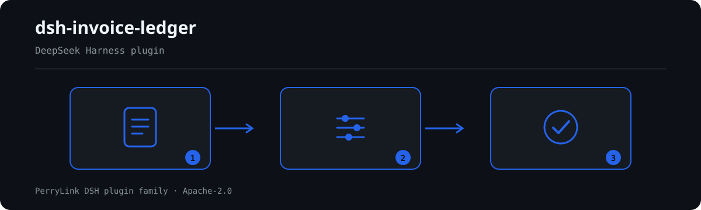

# dsh-invoice-ledger — Invoice ledger (हिन्दी)

[English](README.md) · [简体中文](README-zh.md) · [Español](README-es.md) · [Português](README-pt.md) · [हिन्दी](README-hi.md)

[](https://dshfind.com/en/plugins/PerryLink/dsh-invoice-ledger?ref=badge)

`dsh-invoice-ledger` इनवॉइस बही की जाँच करता है: दोहरा दावा, मूल्य और कर का गणित, खरीदार का नाम, असामान्य तिथियाँ, और सेल में बचा टेम्पलेट टेक्स्ट; अंत में विसंगतियों की सूची और एक वर्कबुक देता है।

दो बातें जानबूझकर ऐसी हैं। दोहराव **कोड + नंबर से तय होता है, राशि से कभी नहीं**, इसलिए राशि में गलती होने पर भी वह दोहराव के रूप में दिखेगा। रिपोर्ट उन नियमों को भी नाम लेकर गिनाती है जो इस संस्करण में **नहीं चले**: चार विसंगतियाँ और चौदह बिना चले नियम, चार समस्याएँ नहीं हैं।

## Install

```sh
dsh plugin --profile <name> add dsh-invoice-ledger
dsh --profile <name> --dump-config | grep 'dsh-invoice-ledger'
```

## What it looks like



*Workflow overview: document → rule pack → findings.*

**सीमा:** यह बही की अपने भीतर और इनवॉइस के मुख से तुलना करता है। यह तय नहीं करता कि इनवॉइस नकली है, कारोबार की सच्चाई नहीं जाँचता, कर विभाग से संपर्क नहीं करता, और वित्तीय समीक्षा का विकल्प नहीं है। दर बनाम वस्तु, लगातार नंबर और एक ही दिन की भीड़ जोखिम के संकेत हैं, निष्कर्ष नहीं। इलेक्ट्रॉनिक इनवॉइस नंबर पूरा टेक्स्ट के रूप में रखा जाता है: 20 अंक JavaScript की सुरक्षित पूर्णांक सीमा से बड़े हैं और बदलने पर अंतिम अंक खो जाएँगे।

## What it answers

- क्या वही इनवॉइस दो बार दर्ज है, शायद दो अलग प्रतिपूर्ति पर्चियों में?
- क्या कुल, सहनशीलता के भीतर मूल्य और कर के योग के बराबर है?
- क्या खरीदार वास्तव में यही कंपनी है, या पंजीकृत शाखा?
- क्या जारी करने की तिथि अवधि में है, भविष्य में नहीं है, और आंतरिक समय-सीमा में है?
- किन सेल में अब भी `XX公司` जैसा टेम्पलेट टेक्स्ट है?

और स्पष्ट रूप से: कौन से नियम **नहीं** चले?

## Standards it follows

पैकेज अपने नियमों के स्रोत दस्तावेज़ों को शब्दशः उद्धृत करता है। उदाहरण:

- इलेक्ट्रॉनिक इनवॉइस नंबरिंग: राज्य कर प्रशासन की अधिसूचना 11/2024, अनुच्छेद 4: 20 अंक, पहले दो वर्ष, 3–4 प्रांतीय क्षेत्र, 5 जारी करने का माध्यम, 6–20 क्रमांक।
- गणितीय सर्वसमिकाएँ (कुल = मूल्य + कर) `arithmetic` के रूप में चिह्नित हैं, गढ़े हुए उद्धरण के रूप में नहीं, क्योंकि वे सर्वसमिकाएँ हैं, नियम नहीं।
- जिन नियमों के लिए उद्धरण योग्य धारा नहीं है, वे अपने `excerpt` में यही लिखते हैं, कोई उद्धरण गढ़ते नहीं।

## Compatibility

| Surface | Status |
|---|---|
| Harness | peer range `>=0.1.2-rc.1 <0.2.0 \|\| >=0.2.0-0 <0.3.0` |
| Node | `^22.19.0 || >=24.0.0` |
| Platforms | all (pure ESM; no native code, no network, no model call) |

## What it does

पैकेज प्रत्येक नियम के लिए `params.check.kind` घोषित करता है। यह संस्करण लागू करता है: `invoiceKey`, `moneyEquation`, `uniqueInvoice`, `duplicateAcross`, `dateWindow`, `partyMatch`, `partyCompare`, `placeholderScan`। बाकी सब "नहीं चला" के रूप में, अपने प्रकार के साथ दर्ज होता है।

जिस अंतर को कोई मान्य विशेष स्थिति समझाती है — भेद कराधान, टोल, टिप्पणी में ईंधन — वह **चेतावनी तक घटाया जाता है, छिपाया नहीं जाता**: पाठक संख्या देखकर खुद तय करता है।

## Configuration

| Key | Default | Meaning |
|---|---|---|
| `rulesFile` | `rules/invoice-ledger.yaml` | 规则库路径 |

## Material format

एक पंक्ति में एक इनवॉइस। पैकेज जो फ़ील्ड पढ़ता है उनमें `invoiceCode`, `invoiceNumber`, `docType`, `issueDate`, `amount`, `tax`, `total`, `buyerName`, `buyerTaxId`, `sellerName`, `sellerTaxId`, `formNo`, `reimburser`, `remark` शामिल हैं।

वर्कबुक में तीन शीट हैं: सारांश, विसंगति सूची (प्रत्येक निष्कर्ष के लिए एक पंक्ति), और बिना चले नियम।

## Rule sources

उद्धरण पैकेज में उसी नियम के पास रहते हैं जो उन्हें उपयोग करता है, और `check:citations` जाँचता है कि हर उद्धरण शब्दशः मौजूद है।

प्रकाशित पैकेज का एक दोष दर्ज करने योग्य है: टेम्पलेट पैटर्न में बिना एंकर का `00000000` था, जो लगभग हर 20-अंकीय इनवॉइस नंबर के क्रमांक भाग से मेल खाता है। हर इनवॉइस टेम्पलेट के रूप में चिह्नित हो जाती। पैटर्न अब एंकर किए गए हैं और एक परीक्षण जाँचता है कि वास्तविक नंबर चिह्नित न हो।

## Troubleshooting

- **The plugin installs but the tool never appears**: check that `main` resolves to `lib/index.mjs` and that `pnpm run build` produced it.
- **`dsh plugin add` rejects the package**: the peer range covers `0.1.x` and `0.2.x`; outside it, grant an explicit exemption.
- **A rule did not run**: read the `skipped` array.

## Development

```sh
pnpm install
pnpm run typecheck
pnpm test
pnpm run build
node ../scripts/sync-shared.mjs dsh-invoice-ledger
```

## PerryLink DSH Plugin Family

This project is part of the DeepSeek Harness plugin family from [PerryLink](https://github.com/PerryLink). The roster stays collapsed below so every README keeps a short first screen; expand it to see every row and its status.

<details>
<summary>Expand all plugins</summary>

| Plugin | Status |
|---|---|
| **[dsh-aqua-input-check](https://github.com/PerryLink/dsh-aqua-input-check)** |  |
| **[dsh-archive-check](https://github.com/PerryLink/dsh-archive-check)** |  |
| **[dsh-auto-review](https://github.com/PerryLink/dsh-auto-review)** |  |
| **[dsh-autotier](https://github.com/PerryLink/dsh-autotier)** |  |
| **[dsh-bid-ca-precheck](https://github.com/PerryLink/dsh-bid-ca-precheck)** |  |
| **[dsh-bid-qual-check](https://github.com/PerryLink/dsh-bid-qual-check)** |  |
| **[dsh-cert-mcp](https://github.com/PerryLink/dsh-cert-mcp)** |  |
| **[dsh-checkpoint-rewind](https://github.com/PerryLink/dsh-checkpoint-rewind)** |  |
| **[dsh-click](https://github.com/PerryLink/dsh-click)** |  |
| **[dsh-composer-history](https://github.com/PerryLink/dsh-composer-history)** |  |
| **[dsh-contract-stance](https://github.com/PerryLink/dsh-contract-stance)** |  |
| **[dsh-customs-doc-check](https://github.com/PerryLink/dsh-customs-doc-check)** |  |
| **[dsh-data-quality](https://github.com/PerryLink/dsh-data-quality)** |  |
| **[dsh-demurrage-ledger](https://github.com/PerryLink/dsh-demurrage-ledger)** |  |
| **[dsh-doublecheck](https://github.com/PerryLink/dsh-doublecheck)** |  |
| **[dsh-drill-script-check](https://github.com/PerryLink/dsh-drill-script-check)** |  |
| **[dsh-eia-guide-check](https://github.com/PerryLink/dsh-eia-guide-check)** |  |
| **[dsh-emergency-plan](https://github.com/PerryLink/dsh-emergency-plan)** |  |
| **[dsh-essay-rubric-check](https://github.com/PerryLink/dsh-essay-rubric-check)** |  |
| **[dsh-evidence-check](https://github.com/PerryLink/dsh-evidence-check)** |  |
| **[dsh-export-ctl-check](https://github.com/PerryLink/dsh-export-ctl-check)** |  |
| **[dsh-fast](https://github.com/PerryLink/dsh-fast)** |  |
| **[dsh-fmea-table-check](https://github.com/PerryLink/dsh-fmea-table-check)** |  |
| **[dsh-forecast-penalty](https://github.com/PerryLink/dsh-forecast-penalty)** |  |
| **[dsh-fund-research](https://github.com/PerryLink/dsh-fund-research)** |  |
| **[dsh-github](https://github.com/PerryLink/dsh-github)** |  |
| **[dsh-gongwen-flow-check](https://github.com/PerryLink/dsh-gongwen-flow-check)** |  |
| **[dsh-gongwen-word-check](https://github.com/PerryLink/dsh-gongwen-word-check)** |  |
| **[dsh-guard-plan-qc](https://github.com/PerryLink/dsh-guard-plan-qc)** |  |
| **[dsh-hazchem-check](https://github.com/PerryLink/dsh-hazchem-check)** |  |
| **[dsh-hazplan-check](https://github.com/PerryLink/dsh-hazplan-check)** |  |
| **[dsh-hidden-risk-map](https://github.com/PerryLink/dsh-hidden-risk-map)** |  |
| **[dsh-hs-classify](https://github.com/PerryLink/dsh-hs-classify)** |  |
| **[dsh-icd-rule-check](https://github.com/PerryLink/dsh-icd-rule-check)** |  |
| **[dsh-industry-research](https://github.com/PerryLink/dsh-industry-research)** |  |
| **[dsh-lawcite-adapter](https://github.com/PerryLink/dsh-lawcite-adapter)** |  |
| **[dsh-laya](https://github.com/PerryLink/dsh-laya)** |  |
| **[dsh-lc-doc-check](https://github.com/PerryLink/dsh-lc-doc-check)** |  |
| **[dsh-learning-gap-check](https://github.com/PerryLink/dsh-learning-gap-check)** |  |
| **[dsh-library](https://github.com/PerryLink/dsh-library)** |  |
| **[dsh-local-ai](https://github.com/PerryLink/dsh-local-ai)** |  |
| **[dsh-lsp-actions](https://github.com/PerryLink/dsh-lsp-actions)** |  |
| **[dsh-mask](https://github.com/PerryLink/dsh-mask)** |  |
| **[dsh-mcp-panel](https://github.com/PerryLink/dsh-mcp-panel)** |  |
| **[dsh-medrec-qc](https://github.com/PerryLink/dsh-medrec-qc)** |  |
| **[dsh-memento](https://github.com/PerryLink/dsh-memento)** |  |
| **[dsh-nsfc-form-check](https://github.com/PerryLink/dsh-nsfc-form-check)** |  |
| **[dsh-nurse-record-check](https://github.com/PerryLink/dsh-nurse-record-check)** |  |
| **[dsh-observe](https://github.com/PerryLink/dsh-observe)** |  |
| **[dsh-origin-rvc-check](https://github.com/PerryLink/dsh-origin-rvc-check)** |  |
| **[dsh-ota-review-check](https://github.com/PerryLink/dsh-ota-review-check)** |  |
| **[dsh-output-styles](https://github.com/PerryLink/dsh-output-styles)** |  |
| **[dsh-paper-doc-adapter](https://github.com/PerryLink/dsh-paper-doc-adapter)** |  |
| **[dsh-permission-rules](https://github.com/PerryLink/dsh-permission-rules)** |  |
| **[dsh-permit-report-check](https://github.com/PerryLink/dsh-permit-report-check)** |  |
| **[dsh-pipeline-check](https://github.com/PerryLink/dsh-pipeline-check)** |  |
| **[dsh-pleading-draft](https://github.com/PerryLink/dsh-pleading-draft)** |  |
| **[dsh-plugin-doctor](https://github.com/PerryLink/dsh-plugin-doctor)** |  |
| **[dsh-plugin-guide](https://github.com/PerryLink/dsh-plugin-guide)** |  |
| **[dsh-plugin-kit](https://github.com/PerryLink/dsh-plugin-kit)** |  |
| **[dsh-plugin-upgrade](https://github.com/PerryLink/dsh-plugin-upgrade)** |  |
| **[dsh-policy-brief-draft](https://github.com/PerryLink/dsh-policy-brief-draft)** |  |
| **[dsh-power-loss-split](https://github.com/PerryLink/dsh-power-loss-split)** |  |
| **[dsh-power-ticket-check](https://github.com/PerryLink/dsh-power-ticket-check)** |  |
| **[dsh-ppap-check](https://github.com/PerryLink/dsh-ppap-check)** |  |
| **[dsh-protest-deadline](https://github.com/PerryLink/dsh-protest-deadline)** |  |
| **[dsh-railway-window](https://github.com/PerryLink/dsh-railway-window)** |  |
| **[dsh-repair-order-qc](https://github.com/PerryLink/dsh-repair-order-qc)** |  |
| **[dsh-research-report](https://github.com/PerryLink/dsh-research-report)** |  |
| **[dsh-review-reply-check](https://github.com/PerryLink/dsh-review-reply-check)** |  |
| **[dsh-rulefile-check](https://github.com/PerryLink/dsh-rulefile-check)** |  |
| **[dsh-safety-brief-check](https://github.com/PerryLink/dsh-safety-brief-check)** |  |
| **[dsh-score](https://github.com/PerryLink/dsh-score)** |  |
| **[dsh-session-sync](https://github.com/PerryLink/dsh-session-sync)** |  |
| **[dsh-site-log-check](https://github.com/PerryLink/dsh-site-log-check)** |  |
| **[dsh-skill-pack-security](https://github.com/PerryLink/dsh-skill-pack-security)** |  |
| **[dsh-soe-decision-check](https://github.com/PerryLink/dsh-soe-decision-check)** |  |
| **[dsh-soilwater-check](https://github.com/PerryLink/dsh-soilwater-check)** |  |
| **[dsh-sop-sync-check](https://github.com/PerryLink/dsh-sop-sync-check)** |  |
| **[dsh-spc-gbt-adapter](https://github.com/PerryLink/dsh-spc-gbt-adapter)** |  |
| **[dsh-talk](https://github.com/PerryLink/dsh-talk)** |  |
| **[dsh-tender-extract](https://github.com/PerryLink/dsh-tender-extract)** |  |
| **[dsh-tender-matrix](https://github.com/PerryLink/dsh-tender-matrix)** |  |
| **[dsh-test-drive](https://github.com/PerryLink/dsh-test-drive)** |  |
| **[dsh-ticktick](https://github.com/PerryLink/dsh-ticktick)** |  |
| **[dsh-translate](https://github.com/PerryLink/dsh-translate)** |  |
| **[dsh-warranty-calc](https://github.com/PerryLink/dsh-warranty-calc)** |  |
| **[dsh-budget](https://github.com/PerryLink/dsh-budget)** | 🧊 FROZEN — see the repo README |
| **[dsh-claude-move](https://github.com/PerryLink/dsh-claude-move)** | 🧊 FROZEN — see the repo README |
| **[dsh-defend](https://github.com/PerryLink/dsh-defend)** | 🧊 FROZEN — see the repo README |
| **[dsh-draw](https://github.com/PerryLink/dsh-draw)** | 🧊 FROZEN — see the repo README |
| **[dsh-reach](https://github.com/PerryLink/dsh-reach)** | 🧊 FROZEN — see the repo README |
| **[dsh-background-agents](https://github.com/PerryLink/dsh-background-agents)** | 🚫 RETIRED — see the repo README |
| **[dsh-session-pin](https://github.com/PerryLink/dsh-session-pin)** | 🚫 RETIRED — see the repo README |
| **[dsh-team-rooms](https://github.com/PerryLink/dsh-team-rooms)** | 🚫 RETIRED — see the repo README |

</details>

## License

[Apache License 2.0](LICENSE) © 2026 dsh-invoice-ledger contributors.
