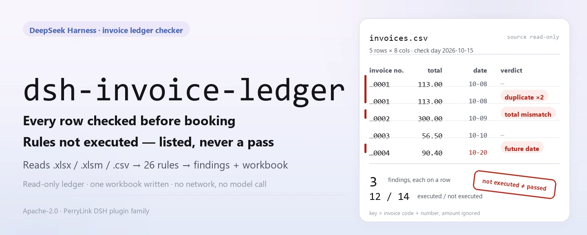
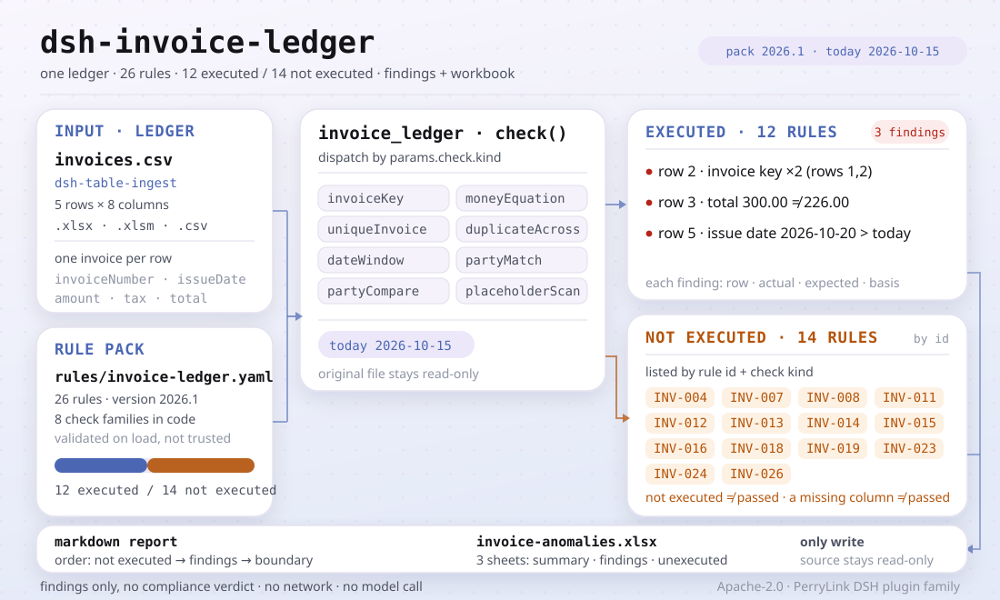

<div align="center">

<picture>
  <source media="(prefers-color-scheme: dark)" srcset="docs/assets/dsh-invoice-ledger-hero-en-dark.webp">
  
</picture>

# dsh-invoice-ledger

**Check the whole invoice ledger before it is booked — every difference points at a row and carries its basis.**

An invoice-ledger checker plugin for DeepSeek Harness, built for finance and reimbursement reviewers: it reads one ledger and checks duplicate claims, arithmetic, buyer identity, dates and template placeholders, then returns an anomaly list plus a three-sheet workbook. It never modifies the original, never goes online and never calls a model.

[Install](#three-step-setup) · [Configuration](#configuration) · [FAQ](#faq) · [简体中文](README.md) · [English](README.en.md)

[](LICENSE)
[](#compatibility)
[](https://www.npmjs.com/package/dsh-invoice-ledger)
[](https://github.com/PerryLink/dsh-invoice-ledger/actions/workflows/ci.yml)
[](#compatibility)

[](https://github.com/PerryLink/dsh-invoice-ledger/stargazers)
[](https://www.npmjs.com/package/dsh-invoice-ledger)
[](https://dshfind.com/plugins/PerryLink/dsh-invoice-ledger?ref=badge)
[](https://securityscorecards.dev/viewer/?uri=github.com/PerryLink/dsh-invoice-ledger)
[](https://gitee.com/perrylink/dsh-invoice-ledger)

```sh
dsh plugin --profile <name> add dsh-invoice-ledger
```

</div>

<sub>Community plugin, not affiliated with DeepSeek. Canonical repository: <https://github.com/PerryLink/dsh-invoice-ledger> (Gitee is a mirror).</sub>

## What it is

`dsh-invoice-ledger` reads an invoice ledger and checks it row by row: whether the same invoice was recorded twice, whether the total equals amount plus tax within tolerance, whether the buyer is this company (or a registered branch), whether the issue date falls inside the period and is not in the future, and whether any cell still carries template text such as a dummy company name. You get an anomaly list that points at the row and gives the actual value, the expected value, a suggested action and the citation, plus a three-sheet workbook.

Two things are deliberate. A duplicate is keyed on **invoice code + number, never on the amount**, so an amount typo still surfaces as a duplicate. And the report lists, by name, every rule this version **could not execute**: a ledger with four findings and fourteen unexecuted rules is not four problems.

<picture>
  <source media="(prefers-color-scheme: dark)" srcset="docs/assets/dsh-invoice-ledger-flow-v5-dark.svg">
  
</picture>

## Three-step setup

1. **Install** (pick one channel):

   ```sh
   # npm channel (recommended, published release)
   dsh plugin --profile <name> add dsh-invoice-ledger
   # git channel (latest main)
   dsh plugin --profile <name> add github:PerryLink/dsh-invoice-ledger
   # tarball channel: pnpm pack in this repo, then
   dsh plugin --profile <name> add ./dsh-invoice-ledger-<version>.tgz
   ```

   Installing from source runs `pnpm install` first: the `prepare` script builds `lib/index.mjs` with tsdown. If scripts were skipped, build once by hand or the tool never appears.

2. **Minimal config** (the defaults work; `cordis.patch.yml` only `insert`s one row):

   ```yaml
   - insert:
       - id: dsh-invoice-ledger
         name: dsh-invoice-ledger
   ```

   Every tunable lives in the Schemastery schema in `src/config.ts`; per-rule thresholds live in `rules/invoice-ledger.yaml`.

3. **Verify it mounts**:

   ```sh
   dsh --profile <name> --dump-config | grep dsh-invoice-ledger
   node samples/quickstart/run.mjs --check
   ```

   The bundled sample is a five-row synthetic ledger (one duplicate, one total that does not add up, one future date) and should print:

   ```text
   invoice_ledger: quickstart OK — output matches expected/result.json
   ```

   *Observed from `samples/quickstart/expected/result.json`*

   The sample input is in `samples/quickstart/input/`, the expected result in `samples/quickstart/expected/result.json`, and a captured run in `docs/assets/quickstart.png`. In a session you can also use the demo prompt recorded in `package.json` (`dsh.demo.prompt`), which asks for a run over the bundled ledger and a severity breakdown of the findings.

**Uninstall**: `dsh plugin --profile <name> remove dsh-invoice-ledger` (or remove the row from the profile patch).

<details>
<summary>Install from the DSH Desktop market</summary>

Every PerryLink plugin is listed in the built-in DSH Desktop market: **Market → Sources → Add source → paste** `https://perrylink-dsh-catalog.perrylink.workers.dev/catalog-source.json` **→ select**. Installation still requires the market's npm identity check and your confirmation.

</details>

## Core capabilities

The plugin registers the `invoice_ledger` tool: it reads one ledger (`.xlsx` / `.xlsm` / `.csv`), applies a versioned rule pack, returns a structured report and writes a workbook.

- **Duplicates keyed on the invoice, never on the amount** — the 20-digit number of a fully digitalized e-invoice and the code + number of a paper invoice are both compared as strings; the same invoice repeated within the batch or across reimbursement forms is reported even when the amount was mistyped.
- **Tax arithmetic** — the total must equal amount plus tax within tolerance (the shipped pack uses 0.02); beyond that it is an `error`, and a difference explained by a recognised special case in the remark (differential taxation, tolls, refined oil) is downgraded to `warn`, not hidden.
- **Buyer and counterparty** — buyer name and tax id are compared with this company, its aliases and registered branches; the seller is the counterparty, so only its name being filled is checked, never compared with our own master data; personal-title invoices are allowed by document-type whitelist.
- **Dates and period** — the issue date must parse, not be in the future, not precede the company start date, and fall inside the period; cross-period, before-contract and past-internal-deadline cases are reported separately.
- **Template placeholders** — buyer, seller, invoice-number and remark cells are scanned for template text; the patterns are anchored, so a real 20-digit e-invoice number is not misreported.
- **Unexecuted rules are listed** — of the pack's 26 rules this version executes 12 and implements 8 check kinds; the other 14 are listed by rule id and check kind. **Not executed is not passed.**
- **Report and workbook** — the Markdown report lists unexecuted rules before findings; the workbook has three sheets: summary, findings (one row per finding) and unexecuted rules.
- **Read-only and local** — the original is never modified, there is no network call and no model call; the only write is the anomaly workbook.

```text
ledger file ──dsh-table-ingest──▶ rows/columns ──26 rules──▶ invoice_ledger ──▶ findings + workbook
                                      ▲                                         │
                                      └───────── unexecuted rules by id ────────┘
```

### What it answers

- Is the same invoice recorded twice, possibly across two reimbursement forms?
- Does the total equal amount plus tax within the configured tolerance?
- Is the buyer actually this company, or a registered branch?
- Is the seller name filled in? The seller is the counterparty, so it is not compared with our own company.
- Is the issue date inside the period, not in the future, and inside the internal deadline?
- Which cells still hold template text such as a dummy company name?

And, explicitly: **which rules did not run?**

## Configuration

Every tunable is a Schemastery field in `src/config.ts`; edit `cordis.yml` and it takes effect without code changes. Per-rule thresholds live in `rules/invoice-ledger.yaml`.

| Key | Type | Default | Meaning |
|---|---|---|---|
| `rulePackFile` | string | `rules/invoice-ledger.yaml` | Rule-pack path, relative to the package root |
| `timeoutMs` | number | `120000` | Tool timeout budget (milliseconds) |
| `workbook` | string | `invoice-anomalies.xlsx` | Anomaly-workbook output filename; empty returns base64 only |

Tool parameters (override per call):

- `file` — absolute path of the ledger (`.xlsx` / `.xlsm` / `.csv`), required.
- `today` — reference date (`YYYY-MM-DD`) for the future-date and deadline checks; defaults to today.
- `rulePackFile` — rule pack to use for this call, overriding the config value.
- `outFile` — where this call writes the workbook; empty uses the configured `workbook`.

Profile-patch override example:

```yaml
- insert:
    - id: dsh-invoice-ledger
      name: dsh-invoice-ledger
      config:
        rulePackFile: rules/invoice-ledger.yaml
        timeoutMs: 180000
        workbook: invoice-anomalies.xlsx
```

> Older docs called the rule-pack key `rulesFile`; the current schema key is `rulePackFile`, as defined in `src/config.ts`.

## FAQ

<details>
<summary>Does it modify my ledger, or upload data?</summary>

No. The tool only reads the ledger you pass and its only write is the anomaly workbook at `outFile` / `workbook`; the plugin is plain ESM with no network call and no model call. If the workbook cannot be written, `workbookPath` is empty but the report and `workbookBase64` are still returned — the result is never dropped silently.

</details>

<details>
<summary>Can "unexecuted" be read as "passed"?</summary>

No. The report lists the unexecuted rules first (id + title + check kind), the workbook has a dedicated unexecuted-rules sheet, and the result carries `unsupportedCount` and `unsupported[]`. A missing input column does not make a check pass — it just reaches no conclusion. "Not executed ≠ passed" is written into the report as a hard statement.

</details>

<details>
<summary>Is cross-period duplication actually checked?</summary>

This version has no history-file entry point: `duplicateAcross` compares reimbursement forms within the current batch only, and the report says so in its notes. To check cross-period duplicates, merge the history ledger into the current material, or wait for a later version that adds the entry point.

</details>

<details>
<summary>It installs, but the tool never appears — what now?</summary>

Check that `main` resolves to `lib/index.mjs` and that `pnpm run build` produced it; installing from git or a tarball runs `prepare` for you, but `--ignore-scripts` skips that build. Then confirm the row is mounted with `dsh --profile <name> --dump-config | grep dsh-invoice-ledger`.

</details>

<details>
<summary>Installation rejects the package as incompatible — what now?</summary>

This package targets DSH `>=0.2.1-0 <0.3.0` and Node `^22.19.0 || >=24.0.0`; the `@deepseek-ai/dsh-tools` peer range is `>=0.1.2-rc.1 <0.2.0 || >=0.2.0-0 <0.3.0`. If your runtime sits outside it, grant the explicit exemption the host offers instead of force-installing an older core.

</details>

## Safety boundary

- **Differences only, no verdict.** The plugin checks the ledger against itself and against the invoice face; it does not decide whether an invoice is fake, does not verify business substance, does not query the tax authority, and does not replace a finance review. Rate-versus-goods, consecutive numbering and same-day clustering are risk prompts, not conclusions.
- **The original is never modified.** The ledger is read-only; the only output is the anomaly workbook at `outFile` or `workbook`.
- **Numbers stay strings.** The 20-digit e-invoice number is kept as a string throughout: it exceeds JavaScript's safe integer range, and converting it would lose the last digits — which would make two different invoices compare equal.
- **Honest citations.** The pack never fabricates a clause: when the exact text is unavailable it says so in `excerpt` and marks the rule `derived-from-principle`; severity follows the evidence (principle-based rules are capped at `warn`, institution thresholds at `info`).
- **Not executed is never "passed".** Checks this version does not implement are listed by name in `unsupported[]` and the unexecuted-rules sheet; when an input column is missing a check may not fire at all — neither case is a pass.

## Known limitations

- **Only 12 of the 26 rules run.** This version implements 8 check kinds: `invoiceKey`, `moneyEquation`, `uniqueInvoice`, `duplicateAcross`, `dateWindow`, `partyMatch`, `partyCompare`, `placeholderScan`; the other 14 are listed by id as unexecuted and never reported as passed.
- **Tables only.** The tool accepts `.xlsx` / `.xlsm` / `.csv` (one invoice per row); scans, images and PDF/OFD files are out of scope, and there is no OCR.
- **Cross-history duplication is not compared.** `duplicateAcross` has no history entry point in this version and compares the current batch only; the report says so and never claims history was checked.
- **Scope is the ledger and the invoice face.** It does not verify invoice authenticity, business substance or deduction eligibility; rate-versus-goods, consecutive numbering and same-day clustering are sampling prompts only.
- **No client UI.** This is a pure host plugin: it registers the `invoice_ledger` tool only, no command, client slot or HTTP route.
- **The pack is replaceable, not fully implementable.** Swap `rules/*.yaml` to switch the rule set; a new rule that uses an unimplemented `kind` is still reported as unexecuted.

## Standards it follows

The pack quotes its sources verbatim, next to the rule that uses them, and `check:citations` verifies every excerpt appears literally. For example:

- E-invoice numbering: State Taxation Administration Announcement No. 11 of 2024, Article 4 — a 20-digit number whose first two digits are the year, digits 3–4 the provincial region, digit 5 the issuance channel, and 6–20 a sequence.
- The arithmetic identities (total = amount + tax) are marked `arithmetic`, not given a fabricated citation, because they are identities, not regulations.
- Rules with no citable clause say so in their own `excerpt` rather than inventing one.

The pack header also records its boundary: it checks the ledger and the invoice face against themselves, does not rule on invoice fraud or business substance, does not replace a tax-authority verification, and does not replace a finance review; rate-versus-goods, consecutive numbering and same-day clustering are risk prompts, not conclusions. The full clause-verification record is in [`rules/evidence/clauses.md`](rules/evidence/clauses.md).

## Material format

One row per invoice. The fields read by the shipped pack include `invoiceCode`, `invoiceNumber`, `docType`, `issueDate`, `amount`, `tax`, `total`, `buyerName`, `buyerTaxId`, `sellerName`, `sellerTaxId`, `formNo`, `reimburser`, `remark`; when a field is missing the affected checks do not reach a conclusion; a missing column is not a pass, and coverage is what `unsupported[]` and the unexecuted-rules sheet say.

The workbook has three sheets:

```text
summary      item / value (rows, errors, warnings, infos, executed / unexecuted rules)
findings     one row per finding: index, severity, rule, row, invoice number, problem,
             actual, expected, suggested action, basis, handling status
unexecuted   rule id / title / check kind
```

The bundled sample supplies only `invoiceNumber`, `docType`, `issueDate`, `amount`, `tax`, `total`, `formNo`, `reimburser`; checks for the missing columns simply do not fire, and they do not fail either.

## Rule sources

Each rule declares `params.check.kind`; quotations live in the pack, next to the rule that uses them, and `check:citations` verifies each appears verbatim.

One defect in the shipped pack is worth recording: its placeholder patterns included an unanchored `00000000`, which matches the sequential part of almost every 20-digit e-invoice number — every invoice would have been flagged as a template placeholder. The patterns are now anchored, and a test asserts that a real number is not flagged. The shipped set is:

```text
^(XX|某某|示例|测试|公司名称|纳税人识别号)$ · .*XX公司.* · .*示例公司.*
^0+$ · ^1+$ · ^12345678$ · ^0{8,}$ · ^1{8,}$
```

## Compatibility

| Surface | Status |
|---|---|
| Harness | `>=0.2.1-0 <0.3.0` (`package.json#engines.dsh`); `@deepseek-ai/dsh-tools` peer range `>=0.1.2-rc.1 <0.2.0 \|\| >=0.2.0-0 <0.3.0` |
| Node | `^22.19.0 \|\| >=24.0.0` |
| Platforms | Anywhere DSH runs (plain ESM; no native code, no network, no model call) |
| Input | `.xlsx` / `.xlsm` / `.csv` ledger, one invoice per row |

## Troubleshooting

- **The plugin installs but the tool never appears.** Check that `main` resolves to `lib/index.mjs` and that `pnpm run build` produced it; a wrong `main` makes the loader skip the entry silently.
- **`dsh plugin add` refuses the package as incompatible.** The peer range covers `0.1.x` and `0.2.x`; if your runtime sits outside it, grant the explicit exemption instead of force-installing an older core.
- **A rule did not run.** Read `unsupported[]` in the result or the unexecuted-rules sheet in the report; not executed is not passed.
- **A finding says the clause text was not obtained.** The pack has a citation gate: it never invents clause text, says so in `excerpt`, and caps the rule at `warn` / `info`. Treat that as a verification gap, not as proof of compliance.
- **Everything is `warn` / `info`.** By design: the plugin makes no legal, tax or safety determination; it lists differences and gaps for a human to decide.

## Ecosystem and quality

- [Gitee mirror](https://gitee.com/perrylink/dsh-invoice-ledger) (synced mirror; GitHub is canonical)
- [dshfind plugin page](https://dshfind.com/plugins/PerryLink/dsh-invoice-ledger) (installs and ranking)
- [OpenSSF Scorecard report](https://securityscorecards.dev/viewer/?uri=github.com/PerryLink/dsh-invoice-ledger) (driven by [.github/workflows/scorecard.yml](.github/workflows/scorecard.yml))
- [Choose a checker by material](https://perrylink.github.io/zh/checkers/choose/) (full family index: 62 checkers + general plugins)
- Docs: [`TROUBLESHOOTING.md`](TROUBLESHOOTING.md) · [`SECURITY.md`](SECURITY.md) · [`CHANGELOG.md`](CHANGELOG.md)

## Development

```sh
pnpm install
pnpm run typecheck   # tsc --noEmit
pnpm test            # vitest: rule behaviour and boundary semantics
pnpm run build       # tsdown -> lib/index.mjs + lib/index.d.mts
pnpm run verify:self-contained
pnpm run check:lockfile
pnpm run check:readmes
pnpm run check:citations
pnpm pack
node ../scripts/sync-shared.mjs dsh-invoice-ledger   # refresh the shared kit
```

| Path | Contents |
|---|---|
| `src/index.ts` | Function-plugin contract: registers `invoice_ledger`, resolves the packaged rule pack |
| `src/config.ts` | Schemastery configuration (3 keys) |
| `src/engine.ts` | Pure check core: pack loading, rule execution, unexecuted-rule listing |
| `src/report.ts` | Markdown report and the three-sheet workbook |
| `src/shared/` | Copied-in shared kit (ruleset loader, YAML subset, date and wording guards, table helpers) |
| `rules/invoice-ledger.yaml` | The rule pack (26 rules) |
| `rules/evidence/clauses.md` | Clause-verification record |
| `tests/` | vitest: rule behaviour and boundary semantics |
| `samples/quickstart/` | One-command quickstart sample |

The rule pack is data, not code: edit `rules/*.yaml` to switch the rule set without touching TypeScript, and the pack is validated on load rather than trusted. README images are generated programmatically by [`scripts/gen-readme-assets.py`](scripts/gen-readme-assets.py) (Pillow for the hero banner, hand-written SVG for the structure diagram) and can be re-run safely; this plugin has no UI, so the images are generated graphics carrying command-surface tokens only.

Topics: `deepseek-harness`, `dsh`, `dsh-plugin`, `cordis`, `invoice`, `ledger`, `reimbursement`, `duplicate`

## Family and credits

This project is part of the DeepSeek Harness plugin family maintained by [PerryLink](https://github.com/PerryLink) (all Apache-2.0). If this plugin helps you, **a star** unlocks nothing but makes it easier for the next person to find.

- [@PerryLink](https://github.com/PerryLink) — creator and maintainer: the rule pack and clause verification, the check core, the report and workbook, and the five-language documentation.

<details>
<summary>Expand all plugins</summary>

| Plugin | Status |
|---|---|
| **[dsh-aqua-input-check](https://github.com/PerryLink/dsh-aqua-input-check)** |  |
| **[dsh-archive-check](https://github.com/PerryLink/dsh-archive-check)** |  |
| **[dsh-auto-review](https://github.com/PerryLink/dsh-auto-review)** |  |
| **[dsh-autotier](https://github.com/PerryLink/dsh-autotier)** | 🧊 FROZEN — see the repo README |
| **[dsh-bid-ca-precheck](https://github.com/PerryLink/dsh-bid-ca-precheck)** |  |
| **[dsh-bid-qual-check](https://github.com/PerryLink/dsh-bid-qual-check)** |  |
| **[dsh-cert-mcp](https://github.com/PerryLink/dsh-cert-mcp)** | 🧊 FROZEN — see the repo README |
| **[dsh-checkpoint-rewind](https://github.com/PerryLink/dsh-checkpoint-rewind)** |  |
| **[dsh-click](https://github.com/PerryLink/dsh-click)** |  |
| **[dsh-composer-history](https://github.com/PerryLink/dsh-composer-history)** |  |
| **[dsh-contract-stance](https://github.com/PerryLink/dsh-contract-stance)** |  |
| **[dsh-customs-doc-check](https://github.com/PerryLink/dsh-customs-doc-check)** |  |
| **[dsh-data-quality](https://github.com/PerryLink/dsh-data-quality)** | 🧊 FROZEN — see the repo README |
| **[dsh-demurrage-ledger](https://github.com/PerryLink/dsh-demurrage-ledger)** |  |
| **[dsh-doublecheck](https://github.com/PerryLink/dsh-doublecheck)** |  |
| **[dsh-drill-script-check](https://github.com/PerryLink/dsh-drill-script-check)** |  |
| **[dsh-eia-guide-check](https://github.com/PerryLink/dsh-eia-guide-check)** |  |
| **[dsh-emergency-plan](https://github.com/PerryLink/dsh-emergency-plan)** |  |
| **[dsh-essay-rubric-check](https://github.com/PerryLink/dsh-essay-rubric-check)** |  |
| **[dsh-evidence-check](https://github.com/PerryLink/dsh-evidence-check)** |  |
| **[dsh-export-ctl-check](https://github.com/PerryLink/dsh-export-ctl-check)** |  |
| **[dsh-fast](https://github.com/PerryLink/dsh-fast)** |  |
| **[dsh-fmea-table-check](https://github.com/PerryLink/dsh-fmea-table-check)** |  |
| **[dsh-forecast-penalty](https://github.com/PerryLink/dsh-forecast-penalty)** |  |
| **[dsh-fund-research](https://github.com/PerryLink/dsh-fund-research)** |  |
| **[dsh-github](https://github.com/PerryLink/dsh-github)** |  |
| **[dsh-gongwen-flow-check](https://github.com/PerryLink/dsh-gongwen-flow-check)** |  |
| **[dsh-gongwen-word-check](https://github.com/PerryLink/dsh-gongwen-word-check)** |  |
| **[dsh-guard-plan-qc](https://github.com/PerryLink/dsh-guard-plan-qc)** |  |
| **[dsh-hazchem-check](https://github.com/PerryLink/dsh-hazchem-check)** |  |
| **[dsh-hazplan-check](https://github.com/PerryLink/dsh-hazplan-check)** |  |
| **[dsh-hidden-risk-map](https://github.com/PerryLink/dsh-hidden-risk-map)** |  |
| **[dsh-hs-classify](https://github.com/PerryLink/dsh-hs-classify)** |  |
| **[dsh-icd-rule-check](https://github.com/PerryLink/dsh-icd-rule-check)** |  |
| **[dsh-industry-research](https://github.com/PerryLink/dsh-industry-research)** |  |
| **[dsh-lawcite-adapter](https://github.com/PerryLink/dsh-lawcite-adapter)** |  |
| **[dsh-laya](https://github.com/PerryLink/dsh-laya)** |  |
| **[dsh-lc-doc-check](https://github.com/PerryLink/dsh-lc-doc-check)** |  |
| **[dsh-learning-gap-check](https://github.com/PerryLink/dsh-learning-gap-check)** |  |
| **[dsh-library](https://github.com/PerryLink/dsh-library)** |  |
| **[dsh-local-ai](https://github.com/PerryLink/dsh-local-ai)** |  |
| **[dsh-lsp-actions](https://github.com/PerryLink/dsh-lsp-actions)** |  |
| **[dsh-mask](https://github.com/PerryLink/dsh-mask)** |  |
| **[dsh-mcp-panel](https://github.com/PerryLink/dsh-mcp-panel)** |  |
| **[dsh-medrec-qc](https://github.com/PerryLink/dsh-medrec-qc)** |  |
| **[dsh-memento](https://github.com/PerryLink/dsh-memento)** | 🧊 FROZEN — see the repo README |
| **[dsh-nsfc-form-check](https://github.com/PerryLink/dsh-nsfc-form-check)** |  |
| **[dsh-nurse-record-check](https://github.com/PerryLink/dsh-nurse-record-check)** |  |
| **[dsh-observe](https://github.com/PerryLink/dsh-observe)** |  |
| **[dsh-origin-rvc-check](https://github.com/PerryLink/dsh-origin-rvc-check)** |  |
| **[dsh-ota-review-check](https://github.com/PerryLink/dsh-ota-review-check)** |  |
| **[dsh-output-styles](https://github.com/PerryLink/dsh-output-styles)** |  |
| **[dsh-paper-doc-adapter](https://github.com/PerryLink/dsh-paper-doc-adapter)** |  |
| **[dsh-permission-rules](https://github.com/PerryLink/dsh-permission-rules)** |  |
| **[dsh-permit-report-check](https://github.com/PerryLink/dsh-permit-report-check)** |  |
| **[dsh-pipeline-check](https://github.com/PerryLink/dsh-pipeline-check)** |  |
| **[dsh-pleading-draft](https://github.com/PerryLink/dsh-pleading-draft)** |  |
| **[dsh-plugin-doctor](https://github.com/PerryLink/dsh-plugin-doctor)** | 🚫 RETIRED (repo archived) |
| **[dsh-plugin-guide](https://github.com/PerryLink/dsh-plugin-guide)** |  |
| **[dsh-plugin-kit](https://github.com/PerryLink/dsh-plugin-kit)** | 🚫 RETIRED (repo archived) |
| **[dsh-plugin-upgrade](https://github.com/PerryLink/dsh-plugin-upgrade)** | 🚫 RETIRED (repo archived) |
| **[dsh-policy-brief-draft](https://github.com/PerryLink/dsh-policy-brief-draft)** |  |
| **[dsh-power-loss-split](https://github.com/PerryLink/dsh-power-loss-split)** |  |
| **[dsh-power-ticket-check](https://github.com/PerryLink/dsh-power-ticket-check)** |  |
| **[dsh-ppap-check](https://github.com/PerryLink/dsh-ppap-check)** |  |
| **[dsh-protest-deadline](https://github.com/PerryLink/dsh-protest-deadline)** |  |
| **[dsh-railway-window](https://github.com/PerryLink/dsh-railway-window)** |  |
| **[dsh-repair-order-qc](https://github.com/PerryLink/dsh-repair-order-qc)** |  |
| **[dsh-research-report](https://github.com/PerryLink/dsh-research-report)** |  |
| **[dsh-review-reply-check](https://github.com/PerryLink/dsh-review-reply-check)** |  |
| **[dsh-rulefile-check](https://github.com/PerryLink/dsh-rulefile-check)** |  |
| **[dsh-safety-brief-check](https://github.com/PerryLink/dsh-safety-brief-check)** |  |
| **[dsh-score](https://github.com/PerryLink/dsh-score)** | 🧊 FROZEN — see the repo README |
| **[dsh-session-sync](https://github.com/PerryLink/dsh-session-sync)** |  |
| **[dsh-site-log-check](https://github.com/PerryLink/dsh-site-log-check)** |  |
| **[dsh-skill-pack-security](https://github.com/PerryLink/dsh-skill-pack-security)** |  |
| **[dsh-soe-decision-check](https://github.com/PerryLink/dsh-soe-decision-check)** |  |
| **[dsh-soilwater-check](https://github.com/PerryLink/dsh-soilwater-check)** |  |
| **[dsh-sop-sync-check](https://github.com/PerryLink/dsh-sop-sync-check)** |  |
| **[dsh-spc-gbt-adapter](https://github.com/PerryLink/dsh-spc-gbt-adapter)** |  |
| **[dsh-talk](https://github.com/PerryLink/dsh-talk)** |  |
| **[dsh-tender-extract](https://github.com/PerryLink/dsh-tender-extract)** |  |
| **[dsh-tender-matrix](https://github.com/PerryLink/dsh-tender-matrix)** |  |
| **[dsh-test-drive](https://github.com/PerryLink/dsh-test-drive)** |  |
| **[dsh-ticktick](https://github.com/PerryLink/dsh-ticktick)** | 🚫 RETIRED (repo archived) |
| **[dsh-translate](https://github.com/PerryLink/dsh-translate)** |  |
| **[dsh-warranty-calc](https://github.com/PerryLink/dsh-warranty-calc)** |  |
| **[dsh-budget](https://github.com/PerryLink/dsh-budget)** | 🧊 FROZEN — see the repo README |
| **[dsh-claude-move](https://github.com/PerryLink/dsh-claude-move)** | 🧊 FROZEN — see the repo README |
| **[dsh-defend](https://github.com/PerryLink/dsh-defend)** | 🧊 FROZEN — see the repo README |
| **[dsh-draw](https://github.com/PerryLink/dsh-draw)** | 🧊 FROZEN — see the repo README |
| **[dsh-reach](https://github.com/PerryLink/dsh-reach)** | 🧊 FROZEN — see the repo README |
| **[dsh-background-agents](https://github.com/PerryLink/dsh-background-agents)** | 🚫 RETIRED (repo archived) |
| **[dsh-session-pin](https://github.com/PerryLink/dsh-session-pin)** | 🚫 RETIRED (repo archived) |
| **[dsh-team-rooms](https://github.com/PerryLink/dsh-team-rooms)** | 🚫 RETIRED (repo archived) |

</details>

## License

[LICENSE](LICENSE) (Apache License 2.0) © 2026 dsh-invoice-ledger contributors

<p align="center"><sub>Apache-2.0 · community plugin, not affiliated with DeepSeek.</sub></p>
