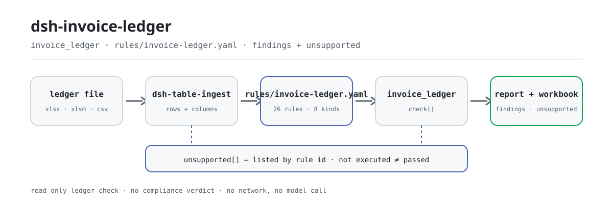

<div align="center">

<picture>
  <source media="(prefers-color-scheme: dark)" srcset="docs/assets/dsh-invoice-ledger-flow-dark.svg">
  
</picture>

# dsh-invoice-ledger

**Revisa todo el libro de facturas antes de contabilizarlo: cada diferencia señala la fila y trae su fundamento.**

Complemento de comprobación de libros de facturas para DeepSeek Harness, pensado para revisores financieros y de reembolsos: lee un libro y comprueba duplicados, aritmética, titular, fechas y plantillas; devuelve una lista de anomalías y un libro de trabajo de tres hojas. No modifica el original, no se conecta a la red y no llama a ningún modelo.

[Instalación](#instalación-en-tres-pasos) · [Configuración](#configuración) · [FAQ](#faq) · [简体中文](README.md) · [English](README.en.md) · [Español](README.es.md) · [Português](README.pt.md) · [हिन्दी](README.hi.md)

[](LICENSE)
[](#compatibilidad)
[](https://www.npmjs.com/package/dsh-invoice-ledger)
[](https://github.com/PerryLink/dsh-invoice-ledger/actions/workflows/ci.yml)
[](#compatibilidad)

[](https://github.com/PerryLink/dsh-invoice-ledger/stargazers)
[](https://www.npmjs.com/package/dsh-invoice-ledger)
[](https://dshfind.com/plugins/PerryLink/dsh-invoice-ledger?ref=badge)
[](https://securityscorecards.dev/viewer/?uri=github.com/PerryLink/dsh-invoice-ledger)
[](https://gitee.com/perrylink/dsh-invoice-ledger)

```sh
dsh plugin --profile <name> add dsh-invoice-ledger
```

</div>

<sub>Complemento comunitario, no afiliado a DeepSeek. Repositorio canónico: <https://github.com/PerryLink/dsh-invoice-ledger> (Gitee es un espejo).</sub>

## Qué es

`dsh-invoice-ledger` lee un libro de facturas y lo revisa fila a fila: si la misma factura está registrada dos veces, si el total es igual a la base más el impuesto dentro de la tolerancia, si el comprador es esta empresa (o una sucursal registrada), si la fecha de emisión cae dentro del periodo y no está en el futuro, y si alguna celda conserva texto de plantilla. Devuelve una lista de anomalías que señala la fila y da el valor real, el esperado, la acción sugerida y el fundamento, más un libro de trabajo de tres hojas.

Hay dos decisiones deliberadas. Un duplicado se identifica por **código + número de factura, nunca por el importe**, así que un error en el importe sigue apareciendo como duplicado. Y el informe enumera, una por una, todas las reglas que esta versión **no pudo ejecutar**: un libro con cuatro hallazgos y catorce reglas sin ejecutar no son cuatro problemas.

## Instalación en tres pasos

1. **Instalar** (elige un canal):

   ```sh
   # canal npm (recomendado, versión publicada)
   dsh plugin --profile <name> add dsh-invoice-ledger
   # canal git (última main)
   dsh plugin --profile <name> add github:PerryLink/dsh-invoice-ledger
   # canal tarball: tras pnpm pack en este repositorio
   dsh plugin --profile <name> add ./dsh-invoice-ledger-<version>.tgz
   ```

   Instalar desde el código ejecuta antes `pnpm install`: el script `prepare` construye `lib/index.mjs` con tsdown. Si se omiten los scripts, hay que compilar una vez a mano o la herramienta no aparecerá.

2. **Configuración mínima** (los valores por defecto funcionan; `cordis.patch.yml` solo `insert`a una fila):

   ```yaml
   - insert:
       - id: dsh-invoice-ledger
         name: dsh-invoice-ledger
   ```

   Todos los parámetros ajustables viven en el esquema Schemastery de `src/config.ts`; los umbrales de cada regla, en `rules/invoice-ledger.yaml`.

3. **Verificar que está montado**:

   ```sh
   dsh --profile <name> --dump-config | grep dsh-invoice-ledger
   node samples/quickstart/run.mjs --check
   ```

   El ejemplo incluido es un libro sintético de cinco filas (un duplicado, un total que no cuadra, una fecha futura) y debe imprimir:

   ```text
   invoice_ledger: quickstart OK — output matches expected/result.json
   ```

   *Observed from `samples/quickstart/expected/result.json`*

   La entrada del ejemplo está en `samples/quickstart/input/`, el resultado esperado en `samples/quickstart/expected/result.json` y una captura de ejecución en `docs/assets/quickstart.png`. En una sesión también puedes decir (el `dsh.demo.prompt` de `package.json`):

   ```text
   用自带样例核对一遍发票台账，告诉我发现了几条问题、分别是什么级别。
   ```

**Desinstalar**: `dsh plugin --profile <name> remove dsh-invoice-ledger` (o borra la fila del patch del perfil).

<details>
<summary>Instalar desde el mercado DSH Desktop</summary>

Todos los complementos de PerryLink se pueden explorar en el mercado integrado de DSH Desktop: **Mercado → Fuentes → Añadir fuente → pegar** `https://perrylink-dsh-catalog.perrylink.workers.dev/catalog-source.json` **→ seleccionar**. La instalación sigue exigiendo la verificación de identidad npm del mercado y tu confirmación.

</details>

## Capacidades principales

El complemento registra la herramienta `invoice_ledger`: lee un libro (`.xlsx` / `.xlsm` / `.csv`), aplica un paquete de reglas versionado, devuelve un informe estructurado y escribe un libro de trabajo.

- **Duplicados por clave de factura, nunca por importe** — el número de 20 dígitos de la factura totalmente digitalizada y el código + número de la factura en papel se comparan como texto; la misma factura repetida dentro del lote o entre hojas de reembolso se informa aunque el importe esté mal escrito.
- **Aritmética de base e impuesto** — el total debe ser igual a la base más el impuesto dentro de la tolerancia (el paquete incluido usa 0,02); por encima es `error`, y una diferencia explicada por un caso especial reconocido en la observación (tributación por diferencia, peajes, combustible) se **degrada a `warn`, no se oculta**.
- **Comprador y contraparte** — el nombre y el NIF del comprador se comparan con esta empresa, sus alias y sus sucursales registradas; el vendedor es la contraparte, así que solo se comprueba que su nombre esté relleno, nunca se compara con nuestros datos maestros; las facturas con titular personal se permiten según una lista blanca de tipos de documento.
- **Fechas y periodo** — la fecha de emisión debe poder interpretarse, no estar en el futuro, no ser anterior a la fecha de constitución y caer dentro del periodo; los casos de cambio de periodo, anteriores al contrato y fuera del plazo interno se informan por separado.
- **Plantillas** — se escanean las celdas de comprador, vendedor, número de factura y observación en busca de texto de plantilla; los patrones están anclados, así que un número real de 20 dígitos no se marca por error.
- **Reglas no ejecutadas a la vista** — de las 26 reglas del paquete, esta versión ejecuta 12 e implementa 8 tipos de comprobación; las otras 14 se listan por id y tipo. **No ejecutada no es aprobada.**
- **Informe y libro de trabajo** — el informe Markdown lista primero las reglas no ejecutadas y después los hallazgos; el libro tiene tres hojas: resumen, lista de anomalías (una fila por hallazgo) y reglas no ejecutadas.
- **Solo lectura y local** — el original no se modifica, no hay llamadas de red ni al modelo; la única escritura es el libro de anomalías.

```text
archivo del libro ──dsh-table-ingest──▶ filas/columnas ──26 reglas──▶ invoice_ledger ──▶ hallazgos + libro
                                          ▲                                                │
                                          └────── reglas no ejecutadas por id ─────────────┘
```

### Qué responde

- ¿La misma factura está registrada dos veces, quizá en dos hojas de reembolso?
- ¿El total coincide con la suma de base e impuesto dentro de la tolerancia?
- ¿El comprador es realmente esta empresa, o una sucursal registrada?
- ¿Está relleno el nombre del vendedor? El vendedor es la contraparte, así que no se compara con el nombre de nuestra empresa.
- ¿La fecha de emisión cae dentro del periodo, no está en el futuro y respeta el plazo interno?
- ¿Qué celdas conservan texto de plantilla, como un nombre de empresa de ejemplo?

Y, explícitamente: **¿qué reglas no se ejecutaron?**

## Configuración

Todos los parámetros ajustables son campos Schemastery en `src/config.ts`; basta editar `cordis.yml` para que surtan efecto, sin tocar el código. Los umbrales de cada regla están en `rules/invoice-ledger.yaml`.

| Clave | Tipo | Valor por defecto | Significado |
|---|---|---|---|
| `rulePackFile` | string | `rules/invoice-ledger.yaml` | Ruta del paquete de reglas, relativa a la raíz del paquete |
| `timeoutMs` | number | `120000` | Presupuesto de tiempo de espera de la herramienta (milisegundos) |
| `workbook` | string | `invoice-anomalies.xlsx` | Nombre del archivo de anomalías; vacío devuelve solo base64 |

Parámetros de la herramienta (se sobrescriben en cada llamada):

- `file` — ruta absoluta del libro (`.xlsx` / `.xlsm` / `.csv`), obligatorio.
- `today` — fecha de referencia (`YYYY-MM-DD`) para las comprobaciones de fecha futura y plazo; por defecto, hoy.
- `rulePackFile` — paquete de reglas de esta llamada, sobrescribe el valor de configuración.
- `outFile` — dónde escribe esta llamada el libro de trabajo; vacío usa el `workbook` configurado.

Ejemplo de sobrescritura en el patch del perfil:

```yaml
- insert:
    - id: dsh-invoice-ledger
      name: dsh-invoice-ledger
      config:
        rulePackFile: rules/invoice-ledger.yaml
        timeoutMs: 180000
        workbook: invoice-anomalies.xlsx
```

> La documentación antigua llamaba `rulesFile` a la clave del paquete de reglas; la clave actual del esquema es `rulePackFile`, definida en `src/config.ts`.

## FAQ

<details>
<summary>¿Modifica mi libro o sube datos a internet?</summary>

No. La herramienta solo lee el libro que le pasas y su única escritura es el libro de anomalías en `outFile` / `workbook`; el complemento es ESM puro, sin llamadas de red ni al modelo. Si el libro no se puede escribir, `workbookPath` queda vacío pero el informe y `workbookBase64` se devuelven igual: el resultado nunca se pierde en silencio.

</details>

<details>
<summary>¿Se puede leer «no ejecutada» como «aprobada»?</summary>

No. El informe lista primero las reglas no ejecutadas (id + título + tipo), el libro tiene una hoja dedicada y el resultado incluye `unsupportedCount` y `unsupported[]`. Que falte una columna de entrada no convierte una comprobación en aprobada: solo no llega a una conclusión. «No ejecutada ≠ aprobada» se escribe en el informe como declaración firme.

</details>

<details>
<summary>¿De verdad se comprueba el duplicado entre periodos?</summary>

Esta versión no tiene punto de entrada para el histórico: `duplicateAcross` solo compara las hojas de reembolso del lote actual, y el informe lo dice en sus notas. Para comprobar duplicados entre periodos, une el histórico al material actual o espera a una versión que añada la entrada.

</details>

<details>
<summary>Se instala, pero la herramienta no aparece: ¿qué hago?</summary>

Comprueba que `main` apunta a `lib/index.mjs` y que `pnpm run build` lo ha generado; al instalar desde git o un tarball, `prepare` compila por ti, pero `--ignore-scripts` omite esa compilación. Después confirma el montaje con `dsh --profile <name> --dump-config | grep dsh-invoice-ledger`.

</details>

<details>
<summary>La instalación rechaza el paquete por incompatibilidad: ¿qué hago?</summary>

Este paquete apunta a DSH `>=0.2.1-0 <0.3.0` y Node `^22.19.0 || >=24.0.0`; el rango peer de `@deepseek-ai/dsh-tools` es `>=0.1.2-rc.1 <0.2.0 || >=0.2.0-0 <0.3.0`. Si tu runtime queda fuera, concede la exención explícita que ofrece el host en vez de forzar un núcleo antiguo.

</details>

## Límite de seguridad

- **Solo diferencias, sin veredicto.** El complemento compara el libro consigo mismo y con la cara de la factura; no decide si una factura es falsa, no verifica la realidad del negocio, no consulta a la autoridad fiscal y no sustituye la revisión financiera. La tasa frente al bien, la numeración consecutiva y la concentración del mismo día son avisos de riesgo, no conclusiones.
- **El original no se modifica.** El libro es de solo lectura; la única salida es el libro de anomalías en `outFile` o `workbook`.
- **Los números siguen siendo texto.** El número de 20 dígitos se guarda como texto de principio a fin: supera el rango entero seguro de JavaScript y convertirlo perdería los últimos dígitos, con lo que dos facturas distintas se compararían como iguales.
- **Citas honestas.** El paquete nunca inventa una cláusula: cuando el texto exacto no está disponible lo dice en `excerpt` y marca la regla como `derived-from-principle`; la gravedad sigue a la evidencia (las reglas de principio tienen tope `warn`, los umbrales de la institución, `info`).
- **Lo no ejecutado nunca es «aprobado».** Las comprobaciones no implementadas se listan por nombre en `unsupported[]` y en la hoja de reglas no ejecutadas; si falta una columna de entrada, puede que la comprobación ni siquiera se dispare: ninguno de los dos casos es un aprobado.

## Limitaciones conocidas

- **Solo se ejecutan 12 de las 26 reglas.** Esta versión implementa 8 tipos de comprobación: `invoiceKey`, `moneyEquation`, `uniqueInvoice`, `duplicateAcross`, `dateWindow`, `partyMatch`, `partyCompare`, `placeholderScan`; las otras 14 se listan por id como no ejecutadas y nunca se informan como aprobadas.
- **Solo tablas.** La herramienta acepta `.xlsx` / `.xlsm` / `.csv` (una factura por fila); escaneos, imágenes y PDF/OFD quedan fuera y no hay OCR.
- **El duplicado histórico no se compara.** `duplicateAcross` no tiene entrada de histórico en esta versión y compara solo el lote actual; el informe lo dice y nunca afirma que el histórico se haya revisado.
- **El alcance es el libro y la cara de la factura.** No verifica autenticidad, realidad del negocio ni elegibilidad para deducir; la tasa frente al bien, la numeración consecutiva y la concentración del mismo día son solo avisos de muestreo.
- **Sin interfaz de cliente.** Es un complemento puramente host: solo registra la herramienta `invoice_ledger`, sin comando, slot de cliente ni ruta HTTP.
- **El paquete se puede sustituir, no está todo implementado.** Cambia `rules/*.yaml` para cambiar el conjunto de reglas; una regla nueva que use un `kind` no implementado seguirá apareciendo como no ejecutada.

## Estándares que sigue

El paquete cita literalmente sus fuentes, junto a la regla que las usa, y `check:citations` verifica que cada extracto aparece tal cual. Por ejemplo:

- Numeración de factura electrónica: Aviso 11/2024 de la Administración Estatal de Impuestos, artículo 4: 20 dígitos, los dos primeros el año, 3–4 la región provincial, el 5 el canal de emisión y 6–20 la secuencia.
- Las identidades aritméticas (total = base + impuesto) se marcan como `arithmetic`, no como una cita inventada, porque son identidades, no normas.
- Las reglas sin cláusula citable lo dicen en su propio `excerpt` en lugar de inventar una.

La cabecera del paquete también declara su límite: comprueba el libro y la cara de la factura contra sí mismos, no dictamina fraude ni realidad del negocio, no sustituye la verificación de la autoridad fiscal y no sustituye la revisión financiera; la tasa frente al bien, la numeración consecutiva y la concentración del mismo día son avisos de riesgo, no conclusiones. El registro completo de verificación de cláusulas está en [`rules/evidence/clauses.md`](rules/evidence/clauses.md).

## Formato del material

Una fila por factura. Los campos que lee el paquete incluido son `invoiceCode`, `invoiceNumber`, `docType`, `issueDate`, `amount`, `tax`, `total`, `buyerName`, `buyerTaxId`, `sellerName`, `sellerTaxId`, `formNo`, `reimburser`, `remark`; cuando falta un campo, las comprobaciones afectadas no llegan a una conclusión; una columna ausente no es un aprobado y la cobertura es lo que dicen `unsupported[]` y la hoja de reglas no ejecutadas.

El libro de trabajo tiene tres hojas:

```text
resumen      elemento / valor (filas, errores, avisos, informativos, reglas ejecutadas / no ejecutadas)
anomalías    una fila por hallazgo: índice, gravedad, regla, fila, número de factura, problema,
             valor real, esperado, acción sugerida, fundamento, estado de tratamiento
no ejecutadas  id de regla / título / tipo de comprobación
```

El ejemplo incluido solo aporta `invoiceNumber`, `docType`, `issueDate`, `amount`, `tax`, `total`, `formNo`, `reimburser`; las comprobaciones de las columnas ausentes simplemente no se disparan, y tampoco fallan.

## Fuentes de las reglas

Cada regla declara `params.check.kind`; las citas viven en el paquete, junto a la regla que las usa, y `check:citations` verifica que cada una aparece literalmente.

Vale la pena registrar un defecto del paquete publicado: sus patrones de plantilla incluían un `00000000` sin anclar, que coincide con la parte secuencial de casi cualquier número de 20 dígitos; todas las facturas se habrían marcado como plantilla. Los patrones ya están anclados y una prueba afirma que un número real no se marca. El conjunto incluido es:

```text
^(XX|某某|示例|测试|公司名称|纳税人识别号)$ · .*XX公司.* · .*示例公司.*
^0+$ · ^1+$ · ^12345678$ · ^0{8,}$ · ^1{8,}$
```

## Compatibilidad

| Superficie | Estado |
|---|---|
| Harness | `>=0.2.1-0 <0.3.0` (`package.json#engines.dsh`); rango peer de `@deepseek-ai/dsh-tools` `>=0.1.2-rc.1 <0.2.0 \|\| >=0.2.0-0 <0.3.0` |
| Node | `^22.19.0 \|\| >=24.0.0` |
| Plataformas | Donde corra DSH (ESM puro; sin código nativo, sin red, sin llamadas al modelo) |
| Entrada | Libro `.xlsx` / `.xlsm` / `.csv`, una factura por fila |

## Solución de problemas

- **El complemento se instala pero la herramienta no aparece.** Comprueba que `main` apunta a `lib/index.mjs` y que `pnpm run build` lo ha generado; un `main` erróneo hace que el cargador omita la entrada en silencio.
- **`dsh plugin add` rechaza el paquete por incompatibilidad.** El rango peer cubre `0.1.x` y `0.2.x`; si tu runtime queda fuera, concede la exención explícita en vez de forzar un núcleo antiguo.
- **Una regla no se ejecutó.** Lee `unsupported[]` en el resultado o la hoja de reglas no ejecutadas del informe; no ejecutada no es aprobada.
- **Un hallazgo dice que no se obtuvo el texto de la cláusula.** El paquete tiene una puerta de citación: no inventa texto, lo dice en `excerpt` y limita la regla a `warn` / `info`. Trátalo como una laguna de verificación, no como prueba de cumplimiento.
- **Todo sale como `warn` / `info`.** Es por diseño: el complemento no dictamina cuestiones legales, fiscales o de seguridad; lista diferencias y lagunas para que una persona decida.

## Ecosistema y calidad

- [Espejo en Gitee](https://gitee.com/perrylink/dsh-invoice-ledger) (espejo sincronizado; GitHub es la referencia)
- [Página del complemento en dshfind](https://dshfind.com/plugins/PerryLink/dsh-invoice-ledger) (instalaciones y ranking)
- [Informe OpenSSF Scorecard](https://securityscorecards.dev/viewer/?uri=github.com/PerryLink/dsh-invoice-ledger) (impulsado por [.github/workflows/scorecard.yml](.github/workflows/scorecard.yml))
- [Elige un comprobador por material](https://perrylink.github.io/zh/checkers/choose/) (índice completo de la familia: 62 comprobadores + complementos generales)
- Documentación: [`TROUBLESHOOTING.md`](TROUBLESHOOTING.md) · [`SECURITY.md`](SECURITY.md) · [`CHANGELOG.md`](CHANGELOG.md)

## Desarrollo

```sh
pnpm install
pnpm run typecheck   # tsc --noEmit
pnpm test            # vitest: comportamiento de reglas y semántica de límites
pnpm run build       # tsdown -> lib/index.mjs + lib/index.d.mts
pnpm run verify:self-contained
pnpm run check:lockfile
pnpm run check:readmes
pnpm run check:citations
pnpm pack
node ../scripts/sync-shared.mjs dsh-invoice-ledger   # actualizar el kit compartido
```

| Ruta | Contenido |
|---|---|
| `src/index.ts` | Contrato de complemento funcional: registra `invoice_ledger`, resuelve el paquete de reglas |
| `src/config.ts` | Configuración Schemastery (3 claves) |
| `src/engine.ts` | Núcleo puro de comprobación: carga del paquete, ejecución, listado de reglas no ejecutadas |
| `src/report.ts` | Informe Markdown y libro de tres hojas |
| `src/shared/` | Kit compartido copiado (cargador de reglas, subconjunto YAML, fechas y guardas de redacción, tablas) |
| `rules/invoice-ledger.yaml` | Paquete de reglas (26 reglas) |
| `rules/evidence/clauses.md` | Registro de verificación de cláusulas |
| `tests/` | vitest: comportamiento de reglas y semántica de límites |
| `samples/quickstart/` | Ejemplo de inicio rápido en un comando |

El paquete de reglas es datos, no código: edita `rules/*.yaml` para cambiar el conjunto sin tocar TypeScript, y el paquete se valida al cargar en vez de confiarse. Las imágenes del README las genera [`scripts/gen-readme-assets.py`](scripts/gen-readme-assets.py) de forma programática (Python + Pillow) y se pueden volver a ejecutar; este complemento no tiene interfaz, así que el hero es un diagrama de flujo SVG dibujado a mano (par claro/oscuro, solo tokens de superficie de comandos).

Topics: `deepseek-harness`, `dsh`, `dsh-plugin`, `cordis`, `invoice`, `ledger`, `reimbursement`, `duplicate`

## Familia y créditos

Este proyecto forma parte de la familia de complementos de DeepSeek Harness mantenida por [PerryLink](https://github.com/PerryLink) (todo Apache-2.0). Si este complemento te ayuda, **una estrella** no desbloquea nada, pero hace que la siguiente persona lo encuentre más fácil.

- [@PerryLink](https://github.com/PerryLink) — creador y mantenedor: el paquete de reglas y su verificación de cláusulas, el núcleo de comprobación, el informe y el libro de trabajo, y la documentación en cinco idiomas.

<details>
<summary>Expandir todos los plugins</summary>

| Plugin | Estado |
|---|---|
| **[dsh-aqua-input-check](https://github.com/PerryLink/dsh-aqua-input-check)** |  |
| **[dsh-archive-check](https://github.com/PerryLink/dsh-archive-check)** |  |
| **[dsh-auto-review](https://github.com/PerryLink/dsh-auto-review)** |  |
| **[dsh-autotier](https://github.com/PerryLink/dsh-autotier)** | 🧊 CONGELADO — ver el README del repo |
| **[dsh-bid-ca-precheck](https://github.com/PerryLink/dsh-bid-ca-precheck)** |  |
| **[dsh-bid-qual-check](https://github.com/PerryLink/dsh-bid-qual-check)** |  |
| **[dsh-cert-mcp](https://github.com/PerryLink/dsh-cert-mcp)** | 🧊 CONGELADO — ver el README del repo |
| **[dsh-checkpoint-rewind](https://github.com/PerryLink/dsh-checkpoint-rewind)** |  |
| **[dsh-click](https://github.com/PerryLink/dsh-click)** |  |
| **[dsh-composer-history](https://github.com/PerryLink/dsh-composer-history)** |  |
| **[dsh-contract-stance](https://github.com/PerryLink/dsh-contract-stance)** |  |
| **[dsh-customs-doc-check](https://github.com/PerryLink/dsh-customs-doc-check)** |  |
| **[dsh-data-quality](https://github.com/PerryLink/dsh-data-quality)** | 🧊 CONGELADO — ver el README del repo |
| **[dsh-demurrage-ledger](https://github.com/PerryLink/dsh-demurrage-ledger)** |  |
| **[dsh-doublecheck](https://github.com/PerryLink/dsh-doublecheck)** |  |
| **[dsh-drill-script-check](https://github.com/PerryLink/dsh-drill-script-check)** |  |
| **[dsh-eia-guide-check](https://github.com/PerryLink/dsh-eia-guide-check)** |  |
| **[dsh-emergency-plan](https://github.com/PerryLink/dsh-emergency-plan)** |  |
| **[dsh-essay-rubric-check](https://github.com/PerryLink/dsh-essay-rubric-check)** |  |
| **[dsh-evidence-check](https://github.com/PerryLink/dsh-evidence-check)** |  |
| **[dsh-export-ctl-check](https://github.com/PerryLink/dsh-export-ctl-check)** |  |
| **[dsh-fast](https://github.com/PerryLink/dsh-fast)** |  |
| **[dsh-fmea-table-check](https://github.com/PerryLink/dsh-fmea-table-check)** |  |
| **[dsh-forecast-penalty](https://github.com/PerryLink/dsh-forecast-penalty)** |  |
| **[dsh-fund-research](https://github.com/PerryLink/dsh-fund-research)** |  |
| **[dsh-github](https://github.com/PerryLink/dsh-github)** |  |
| **[dsh-gongwen-flow-check](https://github.com/PerryLink/dsh-gongwen-flow-check)** |  |
| **[dsh-gongwen-word-check](https://github.com/PerryLink/dsh-gongwen-word-check)** |  |
| **[dsh-guard-plan-qc](https://github.com/PerryLink/dsh-guard-plan-qc)** |  |
| **[dsh-hazchem-check](https://github.com/PerryLink/dsh-hazchem-check)** |  |
| **[dsh-hazplan-check](https://github.com/PerryLink/dsh-hazplan-check)** |  |
| **[dsh-hidden-risk-map](https://github.com/PerryLink/dsh-hidden-risk-map)** |  |
| **[dsh-hs-classify](https://github.com/PerryLink/dsh-hs-classify)** |  |
| **[dsh-icd-rule-check](https://github.com/PerryLink/dsh-icd-rule-check)** |  |
| **[dsh-industry-research](https://github.com/PerryLink/dsh-industry-research)** |  |
| **[dsh-lawcite-adapter](https://github.com/PerryLink/dsh-lawcite-adapter)** |  |
| **[dsh-laya](https://github.com/PerryLink/dsh-laya)** |  |
| **[dsh-lc-doc-check](https://github.com/PerryLink/dsh-lc-doc-check)** |  |
| **[dsh-learning-gap-check](https://github.com/PerryLink/dsh-learning-gap-check)** |  |
| **[dsh-library](https://github.com/PerryLink/dsh-library)** |  |
| **[dsh-local-ai](https://github.com/PerryLink/dsh-local-ai)** |  |
| **[dsh-lsp-actions](https://github.com/PerryLink/dsh-lsp-actions)** |  |
| **[dsh-mask](https://github.com/PerryLink/dsh-mask)** |  |
| **[dsh-mcp-panel](https://github.com/PerryLink/dsh-mcp-panel)** |  |
| **[dsh-medrec-qc](https://github.com/PerryLink/dsh-medrec-qc)** |  |
| **[dsh-memento](https://github.com/PerryLink/dsh-memento)** | 🧊 CONGELADO — ver el README del repo |
| **[dsh-nsfc-form-check](https://github.com/PerryLink/dsh-nsfc-form-check)** |  |
| **[dsh-nurse-record-check](https://github.com/PerryLink/dsh-nurse-record-check)** |  |
| **[dsh-observe](https://github.com/PerryLink/dsh-observe)** |  |
| **[dsh-origin-rvc-check](https://github.com/PerryLink/dsh-origin-rvc-check)** |  |
| **[dsh-ota-review-check](https://github.com/PerryLink/dsh-ota-review-check)** |  |
| **[dsh-output-styles](https://github.com/PerryLink/dsh-output-styles)** |  |
| **[dsh-paper-doc-adapter](https://github.com/PerryLink/dsh-paper-doc-adapter)** |  |
| **[dsh-permission-rules](https://github.com/PerryLink/dsh-permission-rules)** |  |
| **[dsh-permit-report-check](https://github.com/PerryLink/dsh-permit-report-check)** |  |
| **[dsh-pipeline-check](https://github.com/PerryLink/dsh-pipeline-check)** |  |
| **[dsh-pleading-draft](https://github.com/PerryLink/dsh-pleading-draft)** |  |
| **[dsh-plugin-doctor](https://github.com/PerryLink/dsh-plugin-doctor)** | 🚫 RETIRADO (repo archivado) |
| **[dsh-plugin-guide](https://github.com/PerryLink/dsh-plugin-guide)** |  |
| **[dsh-plugin-kit](https://github.com/PerryLink/dsh-plugin-kit)** | 🚫 RETIRADO (repo archivado) |
| **[dsh-plugin-upgrade](https://github.com/PerryLink/dsh-plugin-upgrade)** | 🚫 RETIRADO (repo archivado) |
| **[dsh-policy-brief-draft](https://github.com/PerryLink/dsh-policy-brief-draft)** |  |
| **[dsh-power-loss-split](https://github.com/PerryLink/dsh-power-loss-split)** |  |
| **[dsh-power-ticket-check](https://github.com/PerryLink/dsh-power-ticket-check)** |  |
| **[dsh-ppap-check](https://github.com/PerryLink/dsh-ppap-check)** |  |
| **[dsh-protest-deadline](https://github.com/PerryLink/dsh-protest-deadline)** |  |
| **[dsh-railway-window](https://github.com/PerryLink/dsh-railway-window)** |  |
| **[dsh-repair-order-qc](https://github.com/PerryLink/dsh-repair-order-qc)** |  |
| **[dsh-research-report](https://github.com/PerryLink/dsh-research-report)** |  |
| **[dsh-review-reply-check](https://github.com/PerryLink/dsh-review-reply-check)** |  |
| **[dsh-rulefile-check](https://github.com/PerryLink/dsh-rulefile-check)** |  |
| **[dsh-safety-brief-check](https://github.com/PerryLink/dsh-safety-brief-check)** |  |
| **[dsh-score](https://github.com/PerryLink/dsh-score)** | 🧊 CONGELADO — ver el README del repo |
| **[dsh-session-sync](https://github.com/PerryLink/dsh-session-sync)** |  |
| **[dsh-site-log-check](https://github.com/PerryLink/dsh-site-log-check)** |  |
| **[dsh-skill-pack-security](https://github.com/PerryLink/dsh-skill-pack-security)** |  |
| **[dsh-soe-decision-check](https://github.com/PerryLink/dsh-soe-decision-check)** |  |
| **[dsh-soilwater-check](https://github.com/PerryLink/dsh-soilwater-check)** |  |
| **[dsh-sop-sync-check](https://github.com/PerryLink/dsh-sop-sync-check)** |  |
| **[dsh-spc-gbt-adapter](https://github.com/PerryLink/dsh-spc-gbt-adapter)** |  |
| **[dsh-talk](https://github.com/PerryLink/dsh-talk)** |  |
| **[dsh-tender-extract](https://github.com/PerryLink/dsh-tender-extract)** |  |
| **[dsh-tender-matrix](https://github.com/PerryLink/dsh-tender-matrix)** |  |
| **[dsh-test-drive](https://github.com/PerryLink/dsh-test-drive)** |  |
| **[dsh-ticktick](https://github.com/PerryLink/dsh-ticktick)** | 🚫 RETIRADO (repo archivado) |
| **[dsh-translate](https://github.com/PerryLink/dsh-translate)** |  |
| **[dsh-warranty-calc](https://github.com/PerryLink/dsh-warranty-calc)** |  |
| **[dsh-budget](https://github.com/PerryLink/dsh-budget)** | 🧊 CONGELADO — ver el README del repo |
| **[dsh-claude-move](https://github.com/PerryLink/dsh-claude-move)** | 🧊 CONGELADO — ver el README del repo |
| **[dsh-defend](https://github.com/PerryLink/dsh-defend)** | 🧊 CONGELADO — ver el README del repo |
| **[dsh-draw](https://github.com/PerryLink/dsh-draw)** | 🧊 CONGELADO — ver el README del repo |
| **[dsh-reach](https://github.com/PerryLink/dsh-reach)** | 🧊 CONGELADO — ver el README del repo |
| **[dsh-background-agents](https://github.com/PerryLink/dsh-background-agents)** | 🚫 RETIRADO (repo archivado) |
| **[dsh-session-pin](https://github.com/PerryLink/dsh-session-pin)** | 🚫 RETIRADO (repo archivado) |
| **[dsh-team-rooms](https://github.com/PerryLink/dsh-team-rooms)** | 🚫 RETIRADO (repo archivado) |

</details>

## License

[LICENSE](LICENSE) (Apache License 2.0) © 2026 dsh-invoice-ledger contributors

<p align="center"><sub>Apache-2.0 · complemento comunitario, no afiliado a DeepSeek.</sub></p>
