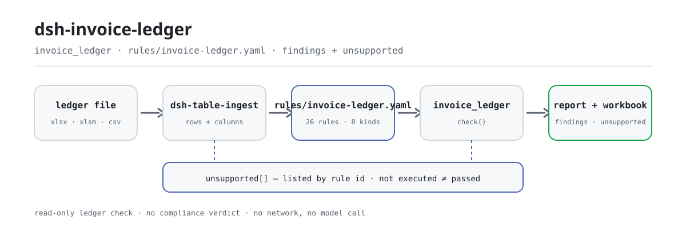

<div align="center">

<picture>
  <source media="(prefers-color-scheme: dark)" srcset="docs/assets/dsh-invoice-ledger-flow-dark.svg">
  
</picture>

# dsh-invoice-ledger

**बही को खाते में डालने से पहले हर पंक्ति जाँचें — हर अंतर पंक्ति दिखाता है और अपना आधार देता है।**

DeepSeek Harness के लिए इनवॉइस बही जाँच प्लगइन, वित्त और प्रतिपूर्ति समीक्षकों के लिए: एक बही पढ़ता है और दोहराव, गणित, खरीदार, तिथियाँ व टेम्पलेट जाँचता है; विसंगति सूची और तीन शीट वाली वर्कबुक देता है। मूल फ़ाइल नहीं बदलता, नेटवर्क पर नहीं जाता, मॉडल नहीं बुलाता।

[इंस्टॉल](#तीन-चरणों-में-शुरुआत) · [कॉन्फ़िगरेशन](#कॉन्फ़िगरेशन) · [FAQ](#faq) · [简体中文](README.md) · [English](README.en.md) · [Español](README.es.md) · [Português](README.pt.md) · [हिन्दी](README.hi.md)

[](LICENSE)
[](#अनुकूलता)
[](https://www.npmjs.com/package/dsh-invoice-ledger)
[](https://github.com/PerryLink/dsh-invoice-ledger/actions/workflows/ci.yml)
[](#अनुकूलता)

[](https://github.com/PerryLink/dsh-invoice-ledger/stargazers)
[](https://www.npmjs.com/package/dsh-invoice-ledger)
[](https://dshfind.com/plugins/PerryLink/dsh-invoice-ledger?ref=badge)
[](https://securityscorecards.dev/viewer/?uri=github.com/PerryLink/dsh-invoice-ledger)
[](https://gitee.com/perrylink/dsh-invoice-ledger)

```sh
dsh plugin --profile <name> add dsh-invoice-ledger
```

</div>

<sub>सामुदायिक प्लगइन, DeepSeek से संबद्ध नहीं। आधिकारिक रेपो: <https://github.com/PerryLink/dsh-invoice-ledger> (Gitee प्रतिबिंब है)।</sub>

## यह क्या है

`dsh-invoice-ledger` एक इनवॉइस बही पढ़कर पंक्ति-दर-पंक्ति जाँचता है: क्या वही इनवॉइस दो बार दर्ज है, क्या कुल सहनशीलता के भीतर मूल्य और कर के योग के बराबर है, क्या खरीदार यही कंपनी (या पंजीकृत शाखा) है, क्या जारी करने की तिथि अवधि में है और भविष्य में नहीं है, और क्या किसी सेल में अब भी टेम्पलेट टेक्स्ट बचा है। परिणाम विसंगतियों की सूची है जो पंक्ति दिखाती है और वास्तविक मान, अपेक्षित मान, सुझाया गया कदम व आधार देती है, साथ में तीन शीट वाली वर्कबुक।

दो बातें जानबूझकर ऐसी हैं। दोहराव **इनवॉइस कोड + नंबर से तय होता है, राशि से कभी नहीं**, इसलिए राशि में गलती होने पर भी वह दोहराव के रूप में दिखेगा। और रिपोर्ट उन हर नियम को नाम लेकर गिनाती है जो इस संस्करण में **नहीं चले**: चार विसंगतियाँ और चौदह बिना चले नियम, चार समस्याएँ नहीं हैं।

## तीन चरणों में शुरुआत

1. **इंस्टॉल करें** (कोई एक चैनल चुनें):

   ```sh
   # npm चैनल (अनुशंसित, प्रकाशित संस्करण)
   dsh plugin --profile <name> add dsh-invoice-ledger
   # git चैनल (नवीनतम main)
   dsh plugin --profile <name> add github:PerryLink/dsh-invoice-ledger
   # tarball चैनल: इस रेपो में pnpm pack के बाद
   dsh plugin --profile <name> add ./dsh-invoice-ledger-<version>.tgz
   ```

   स्रोत से इंस्टॉल करने पर पहले `pnpm install` चलता है: `prepare` स्क्रिप्ट tsdown से `lib/index.mjs` बनाती है। स्क्रिप्ट छोड़ दी जाए तो एक बार हाथ से बिल्ड करें, वरना टूल दिखेगा ही नहीं।

2. **न्यूनतम कॉन्फ़िगरेशन** (डिफ़ॉल्ट चलते हैं; `cordis.patch.yml` केवल एक पंक्ति `insert` करता है):

   ```yaml
   - insert:
       - id: dsh-invoice-ledger
         name: dsh-invoice-ledger
   ```

   सभी समायोज्य विकल्प `src/config.ts` के Schemastery स्कीमा में हैं; प्रत्येक नियम की सीमाएँ `rules/invoice-ledger.yaml` में।

3. **जाँचें कि माउंट हुआ**:

   ```sh
   dsh --profile <name> --dump-config | grep dsh-invoice-ledger
   node samples/quickstart/run.mjs --check
   ```

   साथ दिया नमूना पाँच पंक्तियों की कृत्रिम बही है (एक दोहराव, एक ऐसा कुल जो नहीं जुड़ता, एक भविष्य की तिथि) और यह छापना चाहिए:

   ```text
   invoice_ledger: quickstart OK — output matches expected/result.json
   ```

   *Observed from `samples/quickstart/expected/result.json`*

   नमूना इनपुट `samples/quickstart/input/` में, अपेक्षित परिणाम `samples/quickstart/expected/result.json` में और चलाने का स्क्रीनशॉट `docs/assets/quickstart.png` में है। सत्र में सीधे यह भी कह सकते हैं (`package.json` का `dsh.demo.prompt`):

   ```text
   用自带样例核对一遍发票台账，告诉我发现了几条问题、分别是什么级别。
   ```

**अनइंस्टॉल**: `dsh plugin --profile <name> remove dsh-invoice-ledger` (या प्रोफ़ाइल पैच से वह पंक्ति हटा दें)।

<details>
<summary>DSH Desktop मार्केट से इंस्टॉल करें</summary>

सभी PerryLink प्लगइन DSH Desktop के अंतर्निहित मार्केट में देखे जा सकते हैं: **मार्केट → स्रोत → स्रोत जोड़ें → चिपकाएँ** `https://perrylink-dsh-catalog.perrylink.workers.dev/catalog-source.json` **→ चुनें**। इंस्टॉल के लिए मार्केट की npm पहचान जाँच और आपकी पुष्टि अब भी आवश्यक है।

</details>

## मुख्य क्षमताएँ

प्लगइन `invoice_ledger` टूल पंजीकृत करता है: एक बही (`.xlsx` / `.xlsm` / `.csv`) पढ़ता है, संस्करण-बद्ध नियम पैक लागू करता है, संरचित रिपोर्ट लौटाता है और एक वर्कबुक लिखता है।

- **दोहराव इनवॉइस कुंजी से, राशि से कभी नहीं** — पूरी तरह डिजिटल इनवॉइस का 20 अंकों का नंबर और कागज़ी इनवॉइस का कोड + नंबर दोनों टेक्स्ट के रूप में तुलना होते हैं; वही इनवॉइस बैच के भीतर या प्रतिपूर्ति पर्चियों के बीच दोहराया गया हो तो राशि गलत होने पर भी पकड़ा जाता है।
- **मूल्य और कर का गणित** — कुल सहनशीलता के भीतर मूल्य और कर के योग के बराबर होना चाहिए (साथ दिया पैक 0.02 इस्तेमाल करता है); उससे ऊपर `error` है, और टिप्पणी में पहचानी गई विशेष स्थिति (भेद कराधान, टोल, ईंधन) से समझाया गया अंतर **`warn` तक घटाया जाता है, छिपाया नहीं जाता**।
- **खरीदार और प्रतिपक्ष** — खरीदार का नाम और कर आईडी इस कंपनी, उसके उपनामों और पंजीकृत शाखाओं से तुलना होते हैं; विक्रेता प्रतिपक्ष है, इसलिए केवल नाम भरा होना जाँचा जाता है, हमारे मास्टर डेटा से तुलना नहीं; व्यक्तिगत शीर्षक वाले इनवॉइस दस्तावेज़-प्रकार श्वेतसूची से अनुमत हैं।
- **तिथियाँ और अवधि** — जारी तिथि पढ़ी जा सके, भविष्य में न हो, कंपनी की स्थापना तिथि से पहले न हो और अवधि के भीतर हो; अवधि-पार, अनुबंध-से-पहले और आंतरिक समय-सीमा-पार मामले अलग-अलग दर्ज होते हैं।
- **टेम्पलेट प्लेसहोल्डर** — खरीदार, विक्रेता, इनवॉइस नंबर और टिप्पणी के सेल में टेम्पलेट टेक्स्ट खोजा जाता है; पैटर्न एंकर किए गए हैं, इसलिए असली 20-अंकीय नंबर गलती से चिह्नित नहीं होता।
- **बिना चले नियम सामने** — पैक के 26 नियमों में यह संस्करण 12 चलाता है और 8 प्रकार की जाँच लागू करता है; बाकी 14 नियम आईडी और प्रकार के साथ सूचीबद्ध होते हैं। **नहीं चला, पास नहीं है।**
- **रिपोर्ट और वर्कबुक** — Markdown रिपोर्ट पहले बिना चले नियम, फिर विसंगतियाँ दिखाती है; वर्कबुक में तीन शीट हैं: सारांश, विसंगति सूची (हर निष्कर्ष के लिए एक पंक्ति) और बिना चले नियम।
- **केवल पढ़ना, पूरी तरह स्थानीय** — मूल फ़ाइल नहीं बदलती, नेटवर्क कॉल नहीं, मॉडल कॉल नहीं; एकमात्र लेखन विसंगति वर्कबुक है।

```text
बही फ़ाइल ──dsh-table-ingest──▶ पंक्तियाँ/स्तंभ ──26 नियम──▶ invoice_ledger ──▶ विसंगतियाँ + वर्कबुक
                                   ▲                                                │
                                   └────── बिना चले नियम आईडी से ───────────────────┘
```

### यह किन सवालों का जवाब देता है

- क्या वही इनवॉइस दो बार दर्ज है, शायद दो अलग प्रतिपूर्ति पर्चियों में?
- क्या कुल सहनशीलता के भीतर मूल्य और कर के योग के बराबर है?
- क्या खरीदार वास्तव में यही कंपनी है, या पंजीकृत शाखा?
- क्या विक्रेता का नाम भरा है? विक्रेता प्रतिपक्ष है, इसलिए उसकी तुलना हमारी कंपनी के नाम से नहीं की जाती।
- क्या जारी करने की तिथि अवधि में है, भविष्य में नहीं है, और आंतरिक समय-सीमा में है?
- किन सेल में अब भी टेम्पलेट टेक्स्ट है, जैसे कोई नमूना कंपनी नाम?

और स्पष्ट रूप से: **कौन से नियम नहीं चले?**

## कॉन्फ़िगरेशन

सभी समायोज्य विकल्प `src/config.ts` के Schemastery स्कीमा में हैं; `cordis.yml` बदलते ही लागू होते हैं, कोड बदलने की ज़रूरत नहीं। प्रत्येक नियम की सीमाएँ `rules/invoice-ledger.yaml` में हैं।

| कुंजी | प्रकार | डिफ़ॉल्ट | अर्थ |
|---|---|---|---|
| `rulePackFile` | string | `rules/invoice-ledger.yaml` | नियम पैक का पथ, पैकेज रूट के सापेक्ष |
| `timeoutMs` | number | `120000` | टूल टाइमआउट बजट (मिलीसेकंड) |
| `workbook` | string | `invoice-anomalies.xlsx` | विसंगति वर्कबुक का फ़ाइल नाम; खाली छोड़ने पर केवल base64 लौटता है |

टूल पैरामीटर (प्रत्येक कॉल में ओवरराइड):

- `file` — बही का निरपेक्ष पथ (`.xlsx` / `.xlsm` / `.csv`), आवश्यक।
- `today` — संदर्भ तिथि (`YYYY-MM-DD`), भविष्य-तिथि और समय-सीमा जाँच के लिए; डिफ़ॉल्ट आज।
- `rulePackFile` — इस कॉल का नियम पैक, कॉन्फ़िगरेशन मान को ओवरराइड करता है।
- `outFile` — इस कॉल की वर्कबुक कहाँ लिखी जाए; खाली छोड़ने पर कॉन्फ़िगर किया `workbook`।

प्रोफ़ाइल पैच में ओवरराइड का उदाहरण:

```yaml
- insert:
    - id: dsh-invoice-ledger
      name: dsh-invoice-ledger
      config:
        rulePackFile: rules/invoice-ledger.yaml
        timeoutMs: 180000
        workbook: invoice-anomalies.xlsx
```

> पुराने दस्तावेज़ नियम-पैक कुंजी को `rulesFile` कहते थे; वर्तमान स्कीमा कुंजी `rulePackFile` है, जैसा `src/config.ts` में परिभाषित है।

## FAQ

<details>
<summary>क्या यह मेरी बही बदलता है या डेटा इंटरनेट पर भेजता है?</summary>

नहीं। टूल केवल आपकी दी बही पढ़ता है और उसका एकमात्र लेखन `outFile` / `workbook` पर विसंगति वर्कबुक है; प्लगइन शुद्ध ESM है, नेटवर्क कॉल नहीं, मॉडल कॉल नहीं। वर्कबुक न लिखी जा सके तो `workbookPath` खाली रहता है, पर रिपोर्ट और `workbookBase64` फिर भी लौटते हैं — परिणाम चुपचाप नहीं गिरता।

</details>

<details>
<summary>क्या «नहीं चला» को «पास» पढ़ा जा सकता है?</summary>

नहीं। रिपोर्ट पहले बिना चले नियम (आईडी + शीर्षक + जाँच प्रकार) गिनाती है, वर्कबुक में अलग शीट है, और परिणाम में `unsupportedCount` तथा `unsupported[]` है। इनपुट स्तंभ न होना किसी जाँच को 'पास' नहीं बनाता — वह बस किसी निष्कर्ष तक नहीं पहुँचती। «नहीं चला ≠ पास» रिपोर्ट में स्पष्ट रूप से लिखा जाता है।

</details>

<details>
<summary>क्या अवधि-पार दोहराव वास्तव में जाँचा जाता है?</summary>

इस संस्करण में इतिहास-फ़ाइल का प्रवेश नहीं है: `duplicateAcross` केवल वर्तमान बैच की प्रतिपूर्ति पर्चियों की तुलना करता है, और रिपोर्ट अपने नोट में यह लिखती है। अवधि-पार दोहराव जाँचने के लिए इतिहास को वर्तमान सामग्री में मिलाएँ, या ऐसे संस्करण की प्रतीक्षा करें जो प्रवेश जोड़े।

</details>

<details>
<summary>इंस्टॉल हो गया पर टूल दिखता नहीं — क्या करें?</summary>

देखें कि `main` `lib/index.mjs` की ओर इशारा करता है और `pnpm run build` ने उसे बनाया है; git या tarball से इंस्टॉल करने पर `prepare` स्वयं बिल्ड करता है, पर `--ignore-scripts` वह बिल्ड छोड़ देता है। फिर `dsh --profile <name> --dump-config | grep dsh-invoice-ledger` से माउंट की पुष्टि करें।

</details>

<details>
<summary>इंस्टॉल असंगतता के कारण पैकेज ठुकरा देता है — क्या करें?</summary>

यह पैकेज DSH `>=0.2.1-0 <0.3.0` और Node `^22.19.0 || >=24.0.0` के लिए है; `@deepseek-ai/dsh-tools` का peer रेंज `>=0.1.2-rc.1 <0.2.0 || >=0.2.0-0 <0.3.0` है। आपका रनटाइम इसके बाहर हो तो पुराना कोर ज़बरदस्ती इंस्टॉल करने के बजाय होस्ट द्वारा दी गई स्पष्ट छूट दें।

</details>

## सुरक्षा सीमा

- **केवल अंतर, कोई निर्णय नहीं।** प्लगइन बही की अपने भीतर और इनवॉइस के मुख से तुलना करता है; यह तय नहीं करता कि इनवॉइस नकली है, कारोबार की सच्चाई नहीं जाँचता, कर प्राधिकरण से संपर्क नहीं करता और वित्तीय समीक्षा का विकल्प नहीं है। दर बनाम वस्तु, लगातार नंबर और एक ही दिन की भीड़ जोखिम के संकेत हैं, निष्कर्ष नहीं।
- **मूल फ़ाइल कभी नहीं बदलती।** बही केवल पढ़ी जाती है; एकमात्र आउटपुट `outFile` या `workbook` पर विसंगति वर्कबुक है।
- **नंबर टेक्स्ट ही रहते हैं।** 20-अंकीय नंबर शुरू से अंत तक टेक्स्ट के रूप में रखा जाता है: वह JavaScript की सुरक्षित पूर्णांक सीमा से बड़ा है और बदलने पर अंतिम अंक खो जाएँगे, जिससे दो अलग इनवॉइस बराबर लगेंगी।
- **ईमानदार उद्धरण।** पैक कभी धारा नहीं गढ़ता: सटीक पाठ न मिले तो `excerpt` में लिखता है और नियम को `derived-from-principle` चिह्नित करता है; गंभीरता साक्ष्य के साथ चलती है (सिद्धांत-आधारित नियम `warn` तक सीमित, संस्था-सीमाएँ `info` तक)।
- **नहीं चला कभी «पास» नहीं।** इस संस्करण में अनलागू जाँचें `unsupported[]` और बिना चले नियम शीट में नाम से सूचीबद्ध होती हैं; इनपुट स्तंभ न हो तो जाँच चल ही नहीं सकती — दोनों में से कोई भी «पास» नहीं है।

## ज्ञात सीमाएँ

- **26 में से केवल 12 नियम चलते हैं।** यह संस्करण 8 प्रकार की जाँच लागू करता है: `invoiceKey`, `moneyEquation`, `uniqueInvoice`, `duplicateAcross`, `dateWindow`, `partyMatch`, `partyCompare`, `placeholderScan`; बाकी 14 आईडी से बिना चले के रूप में सूचीबद्ध होते हैं और कभी पास नहीं बताए जाते।
- **केवल तालिकाएँ।** टूल `.xlsx` / `.xlsm` / `.csv` (एक पंक्ति में एक इनवॉइस) लेता है; स्कैन, चित्र और PDF/OFD दायरे से बाहर हैं, OCR नहीं है।
- **इतिहास-दोहराव की तुलना नहीं होती।** इस संस्करण में `duplicateAcross` के पास इतिहास प्रवेश नहीं है और वह केवल वर्तमान बैच की तुलना करता है; रिपोर्ट यह लिखती है और कभी नहीं कहती कि इतिहास जाँचा गया।
- **दायरा बही और इनवॉइस का मुख है।** यह प्रामाणिकता, कारोबार की सच्चाई या कटौती-पात्रता नहीं जाँचता; दर बनाम वस्तु, लगातार नंबर और एक ही दिन की भीड़ केवल नमूना-संकेत हैं।
- **कोई क्लाइंट UI नहीं।** यह शुद्ध होस्ट प्लगइन है: केवल `invoice_ledger` टूल पंजीकृत करता है, कोई कमांड, क्लाइंट स्लॉट या HTTP रूट नहीं।
- **पैक बदला जा सकता है, सब लागू नहीं।** `rules/*.yaml` बदलकर नियम-सेट बदलें; जो नया नियम अनलागू `kind` इस्तेमाल करेगा वह फिर भी बिना चला बताया जाएगा।

## मानक जिनका पालन होता है

पैक अपने स्रोतों को शब्दशः उद्धृत करता है, उसी नियम के पास जो उन्हें उपयोग करता है, और `check:citations` जाँचता है कि हर अंश शब्दशः मौजूद है। उदाहरण:

- इलेक्ट्रॉनिक इनवॉइस नंबरिंग: राज्य कर प्रशासन की अधिसूचना 11/2024, अनुच्छेद 4: 20 अंक, पहले दो वर्ष, 3–4 प्रांतीय क्षेत्र, 5 जारी करने का माध्यम और 6–20 क्रमांक।
- गणितीय सर्वसमिकाएँ (कुल = मूल्य + कर) `arithmetic` के रूप में चिह्नित हैं, गढ़े हुए उद्धरण के रूप में नहीं, क्योंकि वे सर्वसमिकाएँ हैं, नियम नहीं।
- जिन नियमों के लिए उद्धरण योग्य धारा नहीं है, वे अपने `excerpt` में यही लिखते हैं, कोई उद्धरण गढ़ते नहीं।

पैक का शीर्ष भी अपनी सीमा लिखता है: यह बही और इनवॉइस के मुख की अपने भीतर तुलना करता है, इनवॉइस के फ़र्ज़ी होने या कारोबार की सच्चाई पर निर्णय नहीं देता, कर प्राधिकरण के सत्यापन का विकल्प नहीं है और वित्तीय समीक्षा का विकल्प नहीं है; दर बनाम वस्तु, लगातार नंबर और एक ही दिन की भीड़ जोखिम के संकेत हैं, निष्कर्ष नहीं। पूरा धारा-सत्यापन रिकॉर्ड [`rules/evidence/clauses.md`](rules/evidence/clauses.md) में है।

## सामग्री का प्रारूप

एक पंक्ति में एक इनवॉइस। साथ दिए पैक द्वारा पढ़े जाने वाले फ़ील्ड हैं `invoiceCode`, `invoiceNumber`, `docType`, `issueDate`, `amount`, `tax`, `total`, `buyerName`, `buyerTaxId`, `sellerName`, `sellerTaxId`, `formNo`, `reimburser`, `remark`; फ़ील्ड न होने पर संबंधित जाँच किसी निष्कर्ष तक नहीं पहुँचती; अनुपलब्ध स्तंभ 'पास' नहीं है और कवरेज वही है जो `unsupported[]` तथा बिना चले नियम शीट बताते हैं।

वर्कबुक में तीन शीट हैं:

```text
सारांश        मद / मान (पंक्तियाँ, त्रुटियाँ, चेतावनियाँ, सूचनाएँ, चले / बिना चले नियम)
विसंगति सूची  हर निष्कर्ष के लिए एक पंक्ति: क्रम, गंभीरता, नियम, पंक्ति, इनवॉइस नंबर, समस्या,
              वास्तविक, अपेक्षित, सुझाया कदम, आधार, प्रबंधन स्थिति
बिना चले      नियम आईडी / शीर्षक / जाँच प्रकार
```

साथ दिया नमूना केवल `invoiceNumber`, `docType`, `issueDate`, `amount`, `tax`, `total`, `formNo`, `reimburser` देता है; अनुपलब्ध स्तंभों की जाँचें बस नहीं चलतीं, और विफल भी नहीं होतीं।

## नियमों के स्रोत

हर नियम `params.check.kind` घोषित करता है; उद्धरण पैक में उसी नियम के पास रहते हैं जो उन्हें उपयोग करता है, और `check:citations` जाँचता है कि हर उद्धरण शब्दशः मौजूद है।

प्रकाशित पैक का एक दोष दर्ज करने योग्य है: टेम्पलेट पैटर्न में बिना एंकर का `00000000` था, जो लगभग हर 20-अंकीय इनवॉइस नंबर के क्रमांक भाग से मेल खाता है — हर इनवॉइस टेम्पलेट के रूप में चिह्नित हो जाती। पैटर्न अब एंकर किए गए हैं और एक परीक्षण जाँचता है कि वास्तविक नंबर चिह्नित न हो। साथ दिया सेट है:

```text
^(XX|某某|示例|测试|公司名称|纳税人识别号)$ · .*XX公司.* · .*示例公司.*
^0+$ · ^1+$ · ^12345678$ · ^0{8,}$ · ^1{8,}$
```

## अनुकूलता

| सतह | स्थिति |
|---|---|
| Harness | `>=0.2.1-0 <0.3.0` (`package.json#engines.dsh`); `@deepseek-ai/dsh-tools` का peer रेंज `>=0.1.2-rc.1 <0.2.0 \|\| >=0.2.0-0 <0.3.0` |
| Node | `^22.19.0 \|\| >=24.0.0` |
| प्लेटफ़ॉर्म | जहाँ DSH चले (शुद्ध ESM; मूल कोड नहीं, नेटवर्क नहीं, मॉडल कॉल नहीं) |
| इनपुट | `.xlsx` / `.xlsm` / `.csv` बही, एक पंक्ति में एक इनवॉइस |

## समस्या निवारण

- **प्लगइन इंस्टॉल हुआ पर टूल नहीं दिखता।** देखें कि `main` `lib/index.mjs` की ओर इशारा करता है और `pnpm run build` ने उसे बनाया है; गलत `main` लोडर को प्रविष्टि चुपचाप छोड़ने पर मजबूर करता है।
- **`dsh plugin add` असंगतता के कारण मना करता है।** peer रेंज `0.1.x` और `0.2.x` को कवर करती है; रनटाइम बाहर हो तो पुराना कोर ज़बरदस्ती इंस्टॉल करने के बजाय स्पष्ट छूट दें।
- **कोई नियम नहीं चला।** परिणाम में `unsupported[]` या रिपोर्ट की बिना चले नियम शीट पढ़ें; नहीं चला, पास नहीं है।
- **किसी विसंगति में कहा गया है कि धारा का पाठ नहीं मिला।** पैक में उद्धरण-द्वार है: यह पाठ नहीं गढ़ता, `excerpt` में लिखता है और नियम को `warn` / `info` तक सीमित करता है। इसे सत्यापन की कमी मानें, अनुपालन का प्रमाण नहीं।
- **सब कुछ `warn` / `info` आता है।** यह डिज़ाइन है: प्लगइन कानूनी, कर या सुरक्षा निर्णय नहीं देता; अंतर और कमियाँ इंसान के निर्णय के लिए गिनाता है।

## पारिस्थितिकी और गुणवत्ता

- [Gitee प्रतिबिंब](https://gitee.com/perrylink/dsh-invoice-ledger) (समन्वित प्रतिबिंब; GitHub आधिकारिक है)
- [dshfind प्लगइन पृष्ठ](https://dshfind.com/plugins/PerryLink/dsh-invoice-ledger) (इंस्टॉल और रैंकिंग)
- [OpenSSF Scorecard रिपोर्ट](https://securityscorecards.dev/viewer/?uri=github.com/PerryLink/dsh-invoice-ledger) ([.github/workflows/scorecard.yml](.github/workflows/scorecard.yml) द्वारा संचालित)
- [सामग्री के अनुसार जाँचकर्ता चुनें](https://perrylink.github.io/zh/checkers/choose/) (पूरा परिवार सूचकांक: 62 जाँचकर्ता + सामान्य प्लगइन)
- दस्तावेज़: [`TROUBLESHOOTING.md`](TROUBLESHOOTING.md) · [`SECURITY.md`](SECURITY.md) · [`CHANGELOG.md`](CHANGELOG.md)

## विकास

```sh
pnpm install
pnpm run typecheck   # tsc --noEmit
pnpm test            # vitest: नियम व्यवहार और सीमा अर्थशास्त्र
pnpm run build       # tsdown -> lib/index.mjs + lib/index.d.mts
pnpm run verify:self-contained
pnpm run check:lockfile
pnpm run check:readmes
pnpm run check:citations
pnpm pack
node ../scripts/sync-shared.mjs dsh-invoice-ledger   # साझा किट ताज़ा करें
```

| पथ | सामग्री |
|---|---|
| `src/index.ts` | फ़ंक्शन-प्लगइन अनुबंध: `invoice_ledger` पंजीकृत करता है, पैक किया नियम-पैक हल करता है |
| `src/config.ts` | Schemastery कॉन्फ़िगरेशन (3 कुंजियाँ) |
| `src/engine.ts` | शुद्ध जाँच कोर: नियम-पैक लोड, नियम निष्पादन, बिना चले नियमों की सूची |
| `src/report.ts` | Markdown रिपोर्ट और तीन-शीट वर्कबुक |
| `src/shared/` | प्रतिलिपि किया साझा किट (नियम लोडर, YAML उपसमुच्चय, तिथि व शब्द-रक्षक, तालिका सहायक) |
| `rules/invoice-ledger.yaml` | नियम पैक (26 नियम) |
| `rules/evidence/clauses.md` | धारा-सत्यापन रिकॉर्ड |
| `tests/` | vitest: नियम व्यवहार और सीमा अर्थशास्त्र |
| `samples/quickstart/` | एक आदेश में शुरुआती नमूना |

नियम पैक डेटा है, कोड नहीं: `rules/*.yaml` बदलकर TypeScript छुए बिना नियम-सेट बदलें, और पैक लोड के समय जाँचा जाता है, विश्वास नहीं किया जाता। README चित्र [`scripts/gen-readme-assets.py`](scripts/gen-readme-assets.py) से क्रमादेशित रूप से बनते हैं (Python + Pillow) और दोबारा चलाए जा सकते हैं; इस प्लगइन में UI नहीं है, इसलिए हीरो हाथ से लिखा SVG प्रवाह चित्र है (हल्का/गहरा जोड़ी, केवल कमांड-सतह टोकन)।

Topics: `deepseek-harness`, `dsh`, `dsh-plugin`, `cordis`, `invoice`, `ledger`, `reimbursement`, `duplicate`

## परिवार और आभार

यह परियोजना [PerryLink](https://github.com/PerryLink) द्वारा अनुरक्षित DeepSeek Harness प्लगइन परिवार का सदस्य है (सभी Apache-2.0)। अगर यह प्लगइन आपकी मदद करता है, तो **एक स्टार** कुछ अनलॉक नहीं करता, पर अगले व्यक्ति को इसे ढूँढना आसान बनाता है।

- [@PerryLink](https://github.com/PerryLink) — निर्माता और अनुरक्षक: नियम-पैक व धारा-सत्यापन, जाँच कोर, रिपोर्ट व वर्कबुक, और पाँच-भाषा दस्तावेज़।

<details>
<summary>सभी प्लगइन खोलें</summary>

| प्लगइन | स्थिति |
|---|---|
| **[dsh-aqua-input-check](https://github.com/PerryLink/dsh-aqua-input-check)** |  |
| **[dsh-archive-check](https://github.com/PerryLink/dsh-archive-check)** |  |
| **[dsh-auto-review](https://github.com/PerryLink/dsh-auto-review)** |  |
| **[dsh-autotier](https://github.com/PerryLink/dsh-autotier)** | 🧊 फ़्रोज़न — रेपो README देखें |
| **[dsh-bid-ca-precheck](https://github.com/PerryLink/dsh-bid-ca-precheck)** |  |
| **[dsh-bid-qual-check](https://github.com/PerryLink/dsh-bid-qual-check)** |  |
| **[dsh-cert-mcp](https://github.com/PerryLink/dsh-cert-mcp)** | 🧊 फ़्रोज़न — रेपो README देखें |
| **[dsh-checkpoint-rewind](https://github.com/PerryLink/dsh-checkpoint-rewind)** |  |
| **[dsh-click](https://github.com/PerryLink/dsh-click)** |  |
| **[dsh-composer-history](https://github.com/PerryLink/dsh-composer-history)** |  |
| **[dsh-contract-stance](https://github.com/PerryLink/dsh-contract-stance)** |  |
| **[dsh-customs-doc-check](https://github.com/PerryLink/dsh-customs-doc-check)** |  |
| **[dsh-data-quality](https://github.com/PerryLink/dsh-data-quality)** | 🧊 फ़्रोज़न — रेपो README देखें |
| **[dsh-demurrage-ledger](https://github.com/PerryLink/dsh-demurrage-ledger)** |  |
| **[dsh-doublecheck](https://github.com/PerryLink/dsh-doublecheck)** |  |
| **[dsh-drill-script-check](https://github.com/PerryLink/dsh-drill-script-check)** |  |
| **[dsh-eia-guide-check](https://github.com/PerryLink/dsh-eia-guide-check)** |  |
| **[dsh-emergency-plan](https://github.com/PerryLink/dsh-emergency-plan)** |  |
| **[dsh-essay-rubric-check](https://github.com/PerryLink/dsh-essay-rubric-check)** |  |
| **[dsh-evidence-check](https://github.com/PerryLink/dsh-evidence-check)** |  |
| **[dsh-export-ctl-check](https://github.com/PerryLink/dsh-export-ctl-check)** |  |
| **[dsh-fast](https://github.com/PerryLink/dsh-fast)** |  |
| **[dsh-fmea-table-check](https://github.com/PerryLink/dsh-fmea-table-check)** |  |
| **[dsh-forecast-penalty](https://github.com/PerryLink/dsh-forecast-penalty)** |  |
| **[dsh-fund-research](https://github.com/PerryLink/dsh-fund-research)** |  |
| **[dsh-github](https://github.com/PerryLink/dsh-github)** |  |
| **[dsh-gongwen-flow-check](https://github.com/PerryLink/dsh-gongwen-flow-check)** |  |
| **[dsh-gongwen-word-check](https://github.com/PerryLink/dsh-gongwen-word-check)** |  |
| **[dsh-guard-plan-qc](https://github.com/PerryLink/dsh-guard-plan-qc)** |  |
| **[dsh-hazchem-check](https://github.com/PerryLink/dsh-hazchem-check)** |  |
| **[dsh-hazplan-check](https://github.com/PerryLink/dsh-hazplan-check)** |  |
| **[dsh-hidden-risk-map](https://github.com/PerryLink/dsh-hidden-risk-map)** |  |
| **[dsh-hs-classify](https://github.com/PerryLink/dsh-hs-classify)** |  |
| **[dsh-icd-rule-check](https://github.com/PerryLink/dsh-icd-rule-check)** |  |
| **[dsh-industry-research](https://github.com/PerryLink/dsh-industry-research)** |  |
| **[dsh-lawcite-adapter](https://github.com/PerryLink/dsh-lawcite-adapter)** |  |
| **[dsh-laya](https://github.com/PerryLink/dsh-laya)** |  |
| **[dsh-lc-doc-check](https://github.com/PerryLink/dsh-lc-doc-check)** |  |
| **[dsh-learning-gap-check](https://github.com/PerryLink/dsh-learning-gap-check)** |  |
| **[dsh-library](https://github.com/PerryLink/dsh-library)** |  |
| **[dsh-local-ai](https://github.com/PerryLink/dsh-local-ai)** |  |
| **[dsh-lsp-actions](https://github.com/PerryLink/dsh-lsp-actions)** |  |
| **[dsh-mask](https://github.com/PerryLink/dsh-mask)** |  |
| **[dsh-mcp-panel](https://github.com/PerryLink/dsh-mcp-panel)** |  |
| **[dsh-medrec-qc](https://github.com/PerryLink/dsh-medrec-qc)** |  |
| **[dsh-memento](https://github.com/PerryLink/dsh-memento)** | 🧊 फ़्रोज़न — रेपो README देखें |
| **[dsh-nsfc-form-check](https://github.com/PerryLink/dsh-nsfc-form-check)** |  |
| **[dsh-nurse-record-check](https://github.com/PerryLink/dsh-nurse-record-check)** |  |
| **[dsh-observe](https://github.com/PerryLink/dsh-observe)** |  |
| **[dsh-origin-rvc-check](https://github.com/PerryLink/dsh-origin-rvc-check)** |  |
| **[dsh-ota-review-check](https://github.com/PerryLink/dsh-ota-review-check)** |  |
| **[dsh-output-styles](https://github.com/PerryLink/dsh-output-styles)** |  |
| **[dsh-paper-doc-adapter](https://github.com/PerryLink/dsh-paper-doc-adapter)** |  |
| **[dsh-permission-rules](https://github.com/PerryLink/dsh-permission-rules)** |  |
| **[dsh-permit-report-check](https://github.com/PerryLink/dsh-permit-report-check)** |  |
| **[dsh-pipeline-check](https://github.com/PerryLink/dsh-pipeline-check)** |  |
| **[dsh-pleading-draft](https://github.com/PerryLink/dsh-pleading-draft)** |  |
| **[dsh-plugin-doctor](https://github.com/PerryLink/dsh-plugin-doctor)** | 🚫 रिटायर्ड (रेपो संग्रहीत) |
| **[dsh-plugin-guide](https://github.com/PerryLink/dsh-plugin-guide)** |  |
| **[dsh-plugin-kit](https://github.com/PerryLink/dsh-plugin-kit)** | 🚫 रिटायर्ड (रेपो संग्रहीत) |
| **[dsh-plugin-upgrade](https://github.com/PerryLink/dsh-plugin-upgrade)** | 🚫 रिटायर्ड (रेपो संग्रहीत) |
| **[dsh-policy-brief-draft](https://github.com/PerryLink/dsh-policy-brief-draft)** |  |
| **[dsh-power-loss-split](https://github.com/PerryLink/dsh-power-loss-split)** |  |
| **[dsh-power-ticket-check](https://github.com/PerryLink/dsh-power-ticket-check)** |  |
| **[dsh-ppap-check](https://github.com/PerryLink/dsh-ppap-check)** |  |
| **[dsh-protest-deadline](https://github.com/PerryLink/dsh-protest-deadline)** |  |
| **[dsh-railway-window](https://github.com/PerryLink/dsh-railway-window)** |  |
| **[dsh-repair-order-qc](https://github.com/PerryLink/dsh-repair-order-qc)** |  |
| **[dsh-research-report](https://github.com/PerryLink/dsh-research-report)** |  |
| **[dsh-review-reply-check](https://github.com/PerryLink/dsh-review-reply-check)** |  |
| **[dsh-rulefile-check](https://github.com/PerryLink/dsh-rulefile-check)** |  |
| **[dsh-safety-brief-check](https://github.com/PerryLink/dsh-safety-brief-check)** |  |
| **[dsh-score](https://github.com/PerryLink/dsh-score)** | 🧊 फ़्रोज़न — रेपो README देखें |
| **[dsh-session-sync](https://github.com/PerryLink/dsh-session-sync)** |  |
| **[dsh-site-log-check](https://github.com/PerryLink/dsh-site-log-check)** |  |
| **[dsh-skill-pack-security](https://github.com/PerryLink/dsh-skill-pack-security)** |  |
| **[dsh-soe-decision-check](https://github.com/PerryLink/dsh-soe-decision-check)** |  |
| **[dsh-soilwater-check](https://github.com/PerryLink/dsh-soilwater-check)** |  |
| **[dsh-sop-sync-check](https://github.com/PerryLink/dsh-sop-sync-check)** |  |
| **[dsh-spc-gbt-adapter](https://github.com/PerryLink/dsh-spc-gbt-adapter)** |  |
| **[dsh-talk](https://github.com/PerryLink/dsh-talk)** |  |
| **[dsh-tender-extract](https://github.com/PerryLink/dsh-tender-extract)** |  |
| **[dsh-tender-matrix](https://github.com/PerryLink/dsh-tender-matrix)** |  |
| **[dsh-test-drive](https://github.com/PerryLink/dsh-test-drive)** |  |
| **[dsh-ticktick](https://github.com/PerryLink/dsh-ticktick)** | 🚫 रिटायर्ड (रेपो संग्रहीत) |
| **[dsh-translate](https://github.com/PerryLink/dsh-translate)** |  |
| **[dsh-warranty-calc](https://github.com/PerryLink/dsh-warranty-calc)** |  |
| **[dsh-budget](https://github.com/PerryLink/dsh-budget)** | 🧊 फ़्रोज़न — रेपो README देखें |
| **[dsh-claude-move](https://github.com/PerryLink/dsh-claude-move)** | 🧊 फ़्रोज़न — रेपो README देखें |
| **[dsh-defend](https://github.com/PerryLink/dsh-defend)** | 🧊 फ़्रोज़न — रेपो README देखें |
| **[dsh-draw](https://github.com/PerryLink/dsh-draw)** | 🧊 फ़्रोज़न — रेपो README देखें |
| **[dsh-reach](https://github.com/PerryLink/dsh-reach)** | 🧊 फ़्रोज़न — रेपो README देखें |
| **[dsh-background-agents](https://github.com/PerryLink/dsh-background-agents)** | 🚫 रिटायर्ड (रेपो संग्रहीत) |
| **[dsh-session-pin](https://github.com/PerryLink/dsh-session-pin)** | 🚫 रिटायर्ड (रेपो संग्रहीत) |
| **[dsh-team-rooms](https://github.com/PerryLink/dsh-team-rooms)** | 🚫 रिटायर्ड (रेपो संग्रहीत) |

</details>

## License

[LICENSE](LICENSE) (Apache License 2.0) © 2026 dsh-invoice-ledger contributors

<p align="center"><sub>Apache-2.0 · सामुदायिक प्लगइन, DeepSeek से संबद्ध नहीं।</sub></p>
