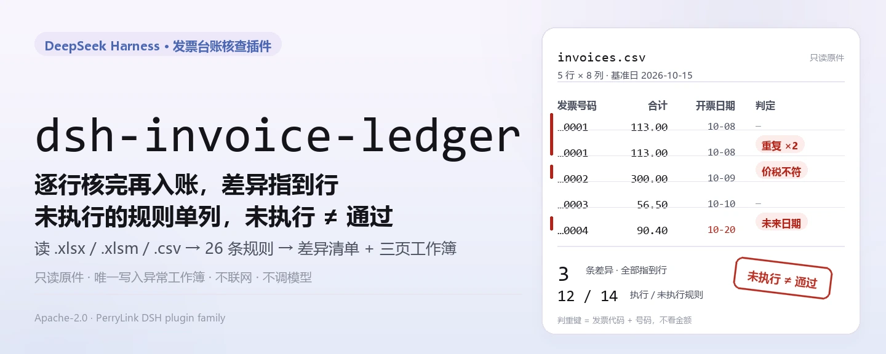
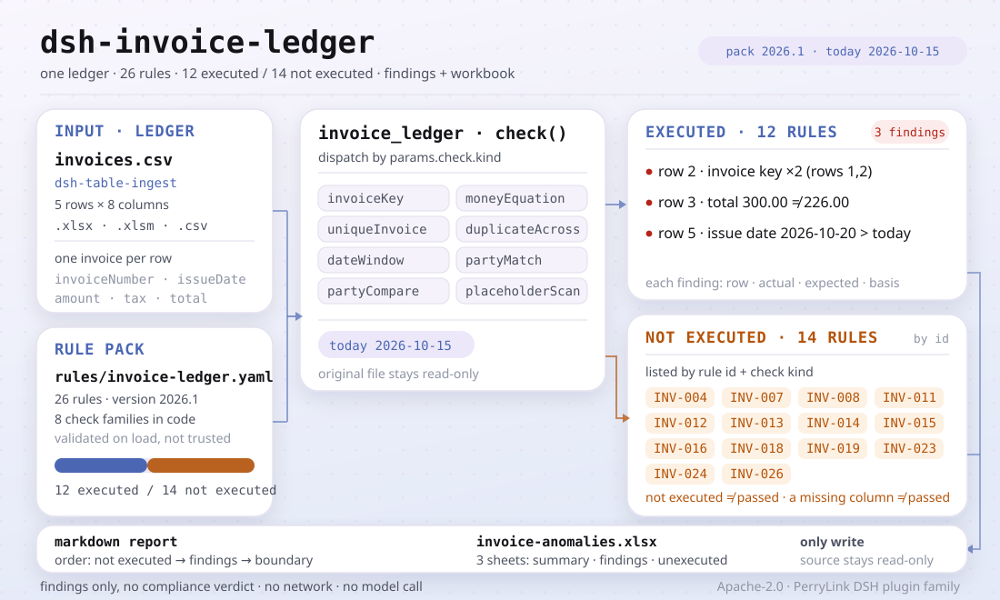

<div align="center">

<picture>
  <source media="(prefers-color-scheme: dark)" srcset="docs/assets/dsh-invoice-ledger-hero-zh-dark.webp">
  
</picture>

# dsh-invoice-ledger

**在发票入账之前把台账逐行核完——每条差异都指到行、给出依据。**

面向财务与报销审核岗的 DeepSeek Harness 检查插件：读一份台账，核对重复报销、价税勾稽、抬头、日期与模板占位符，输出异常清单和三页工作簿；不改原件、不联网、不调用模型。

[安装](#三步上手) · [配置](#配置) · [FAQ](#faq) · [简体中文](README.md) · [English](README.en.md) · [Español](README.es.md) · [Português](README.pt.md) · [हिन्दी](README.hi.md)

[](LICENSE)
[](#兼容性)
[](https://www.npmjs.com/package/dsh-invoice-ledger)
[](https://github.com/PerryLink/dsh-invoice-ledger/actions/workflows/ci.yml)
[](#兼容性)

[](https://github.com/PerryLink/dsh-invoice-ledger/stargazers)
[](https://www.npmjs.com/package/dsh-invoice-ledger)
[](https://dshfind.com/plugins/PerryLink/dsh-invoice-ledger?ref=badge)
[](https://securityscorecards.dev/viewer/?uri=github.com/PerryLink/dsh-invoice-ledger)
[](https://gitee.com/perrylink/dsh-invoice-ledger)

```sh
dsh plugin --profile <name> add dsh-invoice-ledger
```

</div>

<sub>社区插件，与 DeepSeek 官方无关。唯一仓库：<https://github.com/PerryLink/dsh-invoice-ledger>（Gitee 为镜像）。</sub>

## 它是什么

`dsh-invoice-ledger` 读一份发票台账，逐行核对：同一张发票有没有被记两次、价税合计在容差内是否等于金额加税额、购方抬头是不是本公司（或已登记分支机构）、开票日期是否落在所属期且不在未来、单元格里是否还留着 `XX公司` 这类模板文字。结果是一份异常清单（指到行，给出实际值、期望值、建议处理与依据）和一份三页工作簿。

有两处是刻意的：判重只看**发票代码 + 号码，不看金额**，所以金额写错也仍会被判为重复；报告会逐一列出这一版**没有执行**的规则——一份台账报了 4 条差异、另有 14 条规则没跑，不等于只有 4 个问题。

<picture>
  <source media="(prefers-color-scheme: dark)" srcset="docs/assets/dsh-invoice-ledger-flow-v5-dark.svg">
  
</picture>

## 三步上手

1. **安装**（三选一）：

   ```sh
   # npm 通道（推荐，已发布版本）
   dsh plugin --profile <name> add dsh-invoice-ledger
   # git 通道（最新 main）
   dsh plugin --profile <name> add github:PerryLink/dsh-invoice-ledger
   # tarball 通道：本仓库 pnpm pack 后
   dsh plugin --profile <name> add ./dsh-invoice-ledger-<version>.tgz
   ```

   从源码安装会先跑 `pnpm install`：`prepare` 脚本用 tsdown 生成 `lib/index.mjs`；跳过脚本安装时要手动构建一次，否则工具不会出现。

2. **最小配置**（默认即可用；`cordis.patch.yml` 只 `insert` 一行）：

   ```yaml
   - insert:
       - id: dsh-invoice-ledger
         name: dsh-invoice-ledger
   ```

   全部可调项都在 `src/config.ts` 的 Schemastery schema 里；逐条阈值在 `rules/invoice-ledger.yaml`。

3. **验证已生效**：

   ```sh
   dsh --profile <name> --dump-config | grep dsh-invoice-ledger
   node samples/quickstart/run.mjs --check
   ```

   自带样例是一份 5 行合成台账（1 条重复、1 条价税不符、1 条未来日期），应输出：

   ```text
   invoice_ledger: quickstart OK — output matches expected/result.json
   ```

   *Observed from `samples/quickstart/expected/result.json`*

   样例输入在 `samples/quickstart/input/`，期望结果在 `samples/quickstart/expected/result.json`，运行截图见 `docs/assets/quickstart.png`。在会话里也可以直接说（`package.json` 的 `dsh.demo.prompt`）：

   > 用自带样例核对一遍发票台账，告诉我发现了几条问题、分别是什么级别。

**卸载**：`dsh plugin --profile <name> remove dsh-invoice-ledger`（或从 profile patch 删掉该行）。

<details>
<summary>从 DSH Desktop 市场安装</summary>

所有 PerryLink 插件均可在 DSH Desktop 内置市场中浏览：**市场 → 来源 → 添加来源 → 粘贴** `https://perrylink-dsh-catalog.perrylink.workers.dev/catalog-source.json` **→ 选中**。安装仍需通过市场的 npm 身份校验与你的确认。

</details>

## 核心能力

插件注册 `invoice_ledger` 工具：读入一份台账（`.xlsx` / `.xlsm` / `.csv`），套用带版本的规则库，返回结构化报告并写出一份工作簿。

- **判重按发票键，不按金额** —— 数电票的 20 位号码、纸票的代码 + 号码都按字符串比较；同一张发票在本次台账内、跨报销单重复都会报出，金额写错也逃不掉。
- **价税勾稽** —— 价税合计应在容差内等于金额加税额（随包规则库的容差是 0.02）；超出容差报 `error`，备注命中差额征税、通行费、成品油等特殊情形时降级为 `warn`，而不是隐藏。
- **抬头与主体** —— 购方名称、税号与本公司（含别名与已登记分支机构）比对；销方是交易对方，只检查名称是否填写，不拿销方与本公司比较；个人抬头按票种白名单放行。
- **日期与期间** —— 日期必须可解析、不在未来、不早于公司成立日，并落在所属期内；跨年、晚于合同、超过内部申报期限分别提示。
- **模板占位符** —— 扫描购方、销方、发票号码与备注中的模板文字；模式已加锚点，真实的 20 位数电票号码不会被误报。
- **未执行规则单列** —— 规则库 26 条中，这一版执行 12 条、实现 8 类检查；其余 14 条按规则 id 与检查类型列出。**未执行不等于通过。**
- **报告与工作簿** —— Markdown 报告先说未执行规则、再说异常；工作簿三张表：汇总、异常清单（一条发现一行）、未执行规则。
- **只读、纯本地** —— 不改原件；不联网、不调用模型；唯一写操作是异常工作簿。

```text
台账文件 ──dsh-table-ingest──▶ 行/列 ──规则库 26 条──▶ invoice_ledger ──▶ 异常清单 + 工作簿
                                    ▲                                    │
                                    └──── 未执行规则按 id 单列 ──────────┘
```

### 它回答什么问题

- 同一张发票有没有被记两次，甚至跨两张报销单？
- 价税合计在容差内是否等于金额加税额？
- 购方到底是不是本公司，或是已登记的分支机构？
- 销方名称是否填写？（销方是交易对方，不与本公司名称比对。）
- 开票日期是否落在所属期内、不在未来，也在内部申报期限之内？
- 哪些单元格还留着 `XX公司` 这类模板文字？

以及一个必须回答的问题：**哪些规则没有跑？**

## 配置

全部可调参数都在 `src/config.ts` 的 Schemastery schema 中，改 `cordis.yml` 即生效，无需改代码；逐条阈值在 `rules/invoice-ledger.yaml`。

| 键 | 类型 | 默认值 | 说明 |
|---|---|---|---|
| `rulePackFile` | string | `rules/invoice-ledger.yaml` | 规则库路径，相对插件包根目录 |
| `timeoutMs` | number | `120000` | 工具超时预算（毫秒） |
| `workbook` | string | `invoice-anomalies.xlsx` | 异常工作簿输出文件名；留空则只返回 base64 |

工具参数（调用时覆盖）：

- `file` —— 台账文件绝对路径（`.xlsx` / `.xlsm` / `.csv`），必填。
- `today` —— 核对基准日（`YYYY-MM-DD`），用于「未来日期」与时限判断；默认今天。
- `rulePackFile` —— 本次调用使用的规则库路径，覆盖配置值。
- `outFile` —— 本次工作簿写到哪里；留空用配置里的 `workbook`。

profile patch 覆盖示例：

```yaml
- insert:
    - id: dsh-invoice-ledger
      name: dsh-invoice-ledger
      config:
        rulePackFile: rules/invoice-ledger.yaml
        timeoutMs: 180000
        workbook: invoice-anomalies.xlsx
```

> 旧版文档把规则库键写作 `rulesFile`；当前 schema 的键名是 `rulePackFile`，以 `src/config.ts` 为准。

## FAQ

<details>
<summary>它会改我的台账，或把数据传到网上吗？</summary>

不会。工具只读你给的台账文件，唯一写操作是把异常工作簿写到 `outFile` / `workbook`；插件是纯 ESM，不联网、不调用模型。工作簿写失败时 `workbookPath` 为空，但报告与 `workbookBase64` 仍会返回，不静默丢结果。

</details>

<details>
<summary>「未执行」会不会被当成「通过」？</summary>

不会。报告先列未执行的规则（id + 标题 + 检查类型），工作簿单开「未执行规则」表，返回里还有 `unsupportedCount` 与 `unsupported[]`。输入缺列也不会变成通过，只是得不出结论；`未执行 ≠ 通过` 是本插件写进报告的硬性声明。

</details>

<details>
<summary>历史重复真的查了吗？</summary>

本版本没有历史文件入口：`duplicateAcross` 只比对本批次内的报销单，报告会在提示里写明「历史台账比对未执行」。要核对跨期重复，需先把历史台账并入本次材料，或等后续版本提供历史入口。

</details>

<details>
<summary>装上了但看不到工具，怎么办？</summary>

确认 `main` 指向 `lib/index.mjs` 且 `pnpm run build` 已生成它；从 git / tarball 安装时 `prepare` 会构建，若被 `--ignore-scripts` 跳过就要手动构建一次。再看 `dsh --profile <name> --dump-config | grep dsh-invoice-ledger` 是否已挂载。

</details>

<details>
<summary>安装时被判版本不兼容，怎么办？</summary>

本包面向 DSH `>=0.2.1-0 <0.3.0`、Node `^22.19.0 || >=24.0.0`；`@deepseek-ai/dsh-tools` 的 peer 范围是 `>=0.1.2-rc.1 <0.2.0 || >=0.2.0-0 <0.3.0`。运行时在其之外时，按宿主提示显式豁免，不要强装旧核心。

</details>

## 安全边界

- **只列差异，不下结论。** 本插件核对台账内部及台账与发票票面之间的一致性；不判断发票真伪，不核实业务实质，不查询税务机关，也不替代财务复核。税率与货物、连号、同日聚集等只是风险提示，不是结论。
- **不改原件。** 台账只读；输出只有异常工作簿，写到 `outFile` 或 `workbook` 指定的位置。
- **号码按字符串保存。** 数电票号码全程按字符串处理：20 位超出 JavaScript 安全整数范围，转成数字会丢失末位，导致两张不同发票被判为相同。
- **诚实的引用。** 规则库不编造条文：取不到原文就在 `excerpt` 里写明，并标为 `derived-from-principle`；严重级跟着依据走（原则性依据封顶 `warn`，本机构阈值封顶 `info`）。
- **不把未执行当通过。** 本版未实现的检查按名称列进 `unsupported[]` 与「未执行规则」表；输入缺列时检查可能不触发——两者都不是「通过」。

## 已知限制

- **26 条规则里只执行 12 条。** 这一版实现 8 类检查：`invoiceKey`、`moneyEquation`、`uniqueInvoice`、`duplicateAcross`、`dateWindow`、`partyMatch`、`partyCompare`、`placeholderScan`；其余 14 条按 id 列为未执行，不会给出「通过」。
- **输入只有表格。** 工具接受 `.xlsx` / `.xlsm` / `.csv`（一行一张发票）；扫描件、图片、PDF/OFD 不在摄取范围，不做 OCR。
- **历史重复未比对。** `duplicateAcross` 的跨历史台账比对在本版本没有入口，只比对本批次；报告会在提示里说明，不会写成「历史已核对」。
- **核对范围仅限台账与票面。** 不查验发票真伪、不判断业务实质、不判断抵扣资格；税率-品名、连号、同日集中只是抽查提示。
- **没有客户端界面。** 这是纯 host 插件，只注册 `invoice_ledger` 工具，不注册命令、客户端 slot 或 HTTP 路由。
- **规则库可替换，但不保证全实现。** 换 `rules/*.yaml` 即换规则集；新规则若使用未实现的 `kind`，仍会列为未执行。

## 依据的标准

规则库逐字引用它所依据的文件；引文就在使用它的规则旁边，`check:citations` 校验每条摘录都逐字出现。例如：

- 数电票号码：国家税务总局公告 2024 年第 11 号 第四条——20 位号码，前两位是年份，3–4 位是省级区域，第 5 位是开具渠道，6–20 位是顺序码。
- 算术恒等式（合计 = 金额 + 税额）标为 `arithmetic`，不编造条文引用，因为它是恒等式，不是法规。
- 没有可引条文的规则，在自己的 `excerpt` 里如实写明，而不是编一条。

规则库头部还声明了边界：只核对台账/票面自身的一致性与完整性，不判定虚开、不判定业务真实性，不替代税务机关查验，也不替代财务复核；税率-品名、连号、集中开票是风险提示，不是定性结论。完整的条款核验记录在 [`rules/evidence/clauses.md`](rules/evidence/clauses.md)。

## 材料格式

一行一张发票。随包规则库读取的字段包括 `invoiceCode`、`invoiceNumber`、`docType`、`issueDate`、`amount`、`tax`、`total`、`buyerName`、`buyerTaxId`、`sellerName`、`sellerTaxId`、`formNo`、`reimburser`、`remark`；字段缺失时对应检查不会给出结论；缺列不等于通过，覆盖面以「未执行规则」与结果里的 `unsupported[]` 为准。

工作簿有三张表：

```text
汇总        项目 / 值（行数、错误、提示、参考、已执行/未执行规则数）
异常清单    一条发现一行：序号、严重程度、规则、行号、发票号码、问题、实际值、期望值、建议处理、依据、处理状态
未执行规则  规则 id / 标题 / 检查类型
```

自带样例只提供 `invoiceNumber`、`docType`、`issueDate`、`amount`、`tax`、`total`、`formNo`、`reimburser` 八列；未提供的列对应检查不会触发，也不会报错。

## 规则来源

规则库逐条声明 `params.check.kind`；引文就在规则库里、紧挨着使用它的规则，`check:citations` 校验每一条都逐字出现。

随包规则库有一个值得记下的缺陷：占位符模式里曾有一条未加锚点的 `00000000`，几乎能匹配每一张 20 位数电票号码的顺序段——每一张发票都会被报成模板占位符。现在模式已加锚点，并有测试断言真实号码不会被报出。

## 兼容性

| 维度 | 状态 |
|---|---|
| Harness | `>=0.2.1-0 <0.3.0`（`package.json#engines.dsh`）；`@deepseek-ai/dsh-tools` 的 peer 范围为 `>=0.1.2-rc.1 <0.2.0 \|\| >=0.2.0-0 <0.3.0` |
| Node | `^22.19.0 \|\| >=24.0.0` |
| 平台 | 任何 DSH 可运行处（纯 ESM；无原生代码、无联网、不调用模型） |
| 输入 | `.xlsx` / `.xlsm` / `.csv` 台账，一行一张发票 |

## 故障排查

- **插件装上了但工具不出现。** 确认 `main` 指向 `lib/index.mjs` 且 `pnpm run build` 已生成它；`main` 写错会让加载器静默跳过该条目。
- **`dsh plugin add` 以不兼容为由拒绝。** peer 范围覆盖 `0.1.x` 与 `0.2.x`；若运行时在其之外，可显式豁免，不要强装旧核心。
- **某条规则没跑。** 读返回里的 `unsupported[]` 或报告里的「未执行规则」；未执行不等于通过。
- **某条差异说「本次未取得」条款原文。** 规则库有引用门槛：不编条文；摘录做不到逐字时就如实写明，并把规则封顶在 `warn` / `info`。这是核对缺口，不是合规证明。
- **结果全是 `warn` / `info`。** 设计如此：本插件不做法律、税务或安全定性，只列差异与缺口，由人决定怎么处理。

## 生态与质量

- [Gitee 镜像](https://gitee.com/perrylink/dsh-invoice-ledger)（同步镜像，以 GitHub 为准）
- [dshfind 插件页](https://dshfind.com/plugins/PerryLink/dsh-invoice-ledger)（安装量与排名）
- [OpenSSF Scorecard 报告](https://securityscorecards.dev/viewer/?uri=github.com/PerryLink/dsh-invoice-ledger)（由 [.github/workflows/scorecard.yml](.github/workflows/scorecard.yml) 驱动）
- [按材料选核查器](https://perrylink.github.io/zh/checkers/choose/)（完整家族清单：62 个核查器 + 通用插件）
- 文档：[`TROUBLESHOOTING.md`](TROUBLESHOOTING.md) · [`SECURITY.md`](SECURITY.md) · [`CHANGELOG.md`](CHANGELOG.md)

## 开发

```sh
pnpm install
pnpm run typecheck   # tsc --noEmit
pnpm test            # vitest：规则与边界语义
pnpm run build       # tsdown -> lib/index.mjs + lib/index.d.mts
pnpm run verify:self-contained
pnpm run check:lockfile
pnpm run check:readmes
pnpm run check:citations
pnpm pack
node ../scripts/sync-shared.mjs dsh-invoice-ledger   # 刷新时代码共享套件
```

| 路径 | 内容 |
|---|---|
| `src/index.ts` | 函数式插件契约：注册 `invoice_ledger`、解析随包规则库 |
| `src/config.ts` | Schemastery 配置（3 个键） |
| `src/engine.ts` | 纯检查核心：规则库加载、检查执行、未执行规则单列 |
| `src/report.ts` | Markdown 报告与三页工作簿 |
| `src/shared/` | 拷入的共享套件（规则库加载、YAML 子集、日期与措辞守卫、表格助手） |
| `rules/invoice-ledger.yaml` | 规则库（26 条） |
| `rules/evidence/clauses.md` | 条款核验记录 |
| `tests/` | vitest：规则行为与边界语义 |
| `samples/quickstart/` | 一键试跑样例 |

规则库是数据不是代码：改 `rules/*.yaml` 即切换规则集，无需动 TypeScript；规则库在加载期校验，而非被信任。README 配图由 [`scripts/gen-readme-assets.py`](scripts/gen-readme-assets.py) 程序化生成（Python + Pillow 生成 hero 横幅，手写 SVG 生成结构图），可重复执行；本插件无 UI，配图为程序化图形，图内仅命令面 token。

Topics：`deepseek-harness`, `dsh`, `dsh-plugin`, `cordis`, `invoice`, `ledger`, `reimbursement`, `duplicate`

## 家族与致谢

本项目是 [PerryLink](https://github.com/PerryLink) 维护的 DeepSeek Harness 插件家族成员（全部 Apache-2.0）。如果这个插件帮到了你，**给个 star**——它不解锁任何功能，但会让下一个人更容易找到它。

- [@PerryLink](https://github.com/PerryLink) —— 创建者与维护者：规则库与条款核验、检查核心、报告与工作簿、五语文档。

<details>
<summary>展开全部插件</summary>

| 插件 | 状态 |
|---|---|
| **[dsh-aqua-input-check](https://github.com/PerryLink/dsh-aqua-input-check)** |  |
| **[dsh-archive-check](https://github.com/PerryLink/dsh-archive-check)** |  |
| **[dsh-auto-review](https://github.com/PerryLink/dsh-auto-review)** |  |
| **[dsh-autotier](https://github.com/PerryLink/dsh-autotier)** | 🧊 已冻结 — 见仓库 README |
| **[dsh-bid-ca-precheck](https://github.com/PerryLink/dsh-bid-ca-precheck)** |  |
| **[dsh-bid-qual-check](https://github.com/PerryLink/dsh-bid-qual-check)** |  |
| **[dsh-cert-mcp](https://github.com/PerryLink/dsh-cert-mcp)** | 🧊 已冻结 — 见仓库 README |
| **[dsh-checkpoint-rewind](https://github.com/PerryLink/dsh-checkpoint-rewind)** |  |
| **[dsh-click](https://github.com/PerryLink/dsh-click)** |  |
| **[dsh-composer-history](https://github.com/PerryLink/dsh-composer-history)** |  |
| **[dsh-contract-stance](https://github.com/PerryLink/dsh-contract-stance)** |  |
| **[dsh-customs-doc-check](https://github.com/PerryLink/dsh-customs-doc-check)** |  |
| **[dsh-data-quality](https://github.com/PerryLink/dsh-data-quality)** | 🧊 已冻结 — 见仓库 README |
| **[dsh-demurrage-ledger](https://github.com/PerryLink/dsh-demurrage-ledger)** |  |
| **[dsh-doublecheck](https://github.com/PerryLink/dsh-doublecheck)** |  |
| **[dsh-drill-script-check](https://github.com/PerryLink/dsh-drill-script-check)** |  |
| **[dsh-eia-guide-check](https://github.com/PerryLink/dsh-eia-guide-check)** |  |
| **[dsh-emergency-plan](https://github.com/PerryLink/dsh-emergency-plan)** |  |
| **[dsh-essay-rubric-check](https://github.com/PerryLink/dsh-essay-rubric-check)** |  |
| **[dsh-evidence-check](https://github.com/PerryLink/dsh-evidence-check)** |  |
| **[dsh-export-ctl-check](https://github.com/PerryLink/dsh-export-ctl-check)** |  |
| **[dsh-fast](https://github.com/PerryLink/dsh-fast)** |  |
| **[dsh-fmea-table-check](https://github.com/PerryLink/dsh-fmea-table-check)** |  |
| **[dsh-forecast-penalty](https://github.com/PerryLink/dsh-forecast-penalty)** |  |
| **[dsh-fund-research](https://github.com/PerryLink/dsh-fund-research)** |  |
| **[dsh-github](https://github.com/PerryLink/dsh-github)** |  |
| **[dsh-gongwen-flow-check](https://github.com/PerryLink/dsh-gongwen-flow-check)** |  |
| **[dsh-gongwen-word-check](https://github.com/PerryLink/dsh-gongwen-word-check)** |  |
| **[dsh-guard-plan-qc](https://github.com/PerryLink/dsh-guard-plan-qc)** |  |
| **[dsh-hazchem-check](https://github.com/PerryLink/dsh-hazchem-check)** |  |
| **[dsh-hazplan-check](https://github.com/PerryLink/dsh-hazplan-check)** |  |
| **[dsh-hidden-risk-map](https://github.com/PerryLink/dsh-hidden-risk-map)** |  |
| **[dsh-hs-classify](https://github.com/PerryLink/dsh-hs-classify)** |  |
| **[dsh-icd-rule-check](https://github.com/PerryLink/dsh-icd-rule-check)** |  |
| **[dsh-industry-research](https://github.com/PerryLink/dsh-industry-research)** |  |
| **[dsh-lawcite-adapter](https://github.com/PerryLink/dsh-lawcite-adapter)** |  |
| **[dsh-laya](https://github.com/PerryLink/dsh-laya)** |  |
| **[dsh-lc-doc-check](https://github.com/PerryLink/dsh-lc-doc-check)** |  |
| **[dsh-learning-gap-check](https://github.com/PerryLink/dsh-learning-gap-check)** |  |
| **[dsh-library](https://github.com/PerryLink/dsh-library)** |  |
| **[dsh-local-ai](https://github.com/PerryLink/dsh-local-ai)** |  |
| **[dsh-lsp-actions](https://github.com/PerryLink/dsh-lsp-actions)** |  |
| **[dsh-mask](https://github.com/PerryLink/dsh-mask)** |  |
| **[dsh-mcp-panel](https://github.com/PerryLink/dsh-mcp-panel)** |  |
| **[dsh-medrec-qc](https://github.com/PerryLink/dsh-medrec-qc)** |  |
| **[dsh-memento](https://github.com/PerryLink/dsh-memento)** | 🧊 已冻结 — 见仓库 README |
| **[dsh-nsfc-form-check](https://github.com/PerryLink/dsh-nsfc-form-check)** |  |
| **[dsh-nurse-record-check](https://github.com/PerryLink/dsh-nurse-record-check)** |  |
| **[dsh-observe](https://github.com/PerryLink/dsh-observe)** |  |
| **[dsh-origin-rvc-check](https://github.com/PerryLink/dsh-origin-rvc-check)** |  |
| **[dsh-ota-review-check](https://github.com/PerryLink/dsh-ota-review-check)** |  |
| **[dsh-output-styles](https://github.com/PerryLink/dsh-output-styles)** |  |
| **[dsh-paper-doc-adapter](https://github.com/PerryLink/dsh-paper-doc-adapter)** |  |
| **[dsh-permission-rules](https://github.com/PerryLink/dsh-permission-rules)** |  |
| **[dsh-permit-report-check](https://github.com/PerryLink/dsh-permit-report-check)** |  |
| **[dsh-pipeline-check](https://github.com/PerryLink/dsh-pipeline-check)** |  |
| **[dsh-pleading-draft](https://github.com/PerryLink/dsh-pleading-draft)** |  |
| **[dsh-plugin-doctor](https://github.com/PerryLink/dsh-plugin-doctor)** | 🚫 已退役（仓库已归档） |
| **[dsh-plugin-guide](https://github.com/PerryLink/dsh-plugin-guide)** |  |
| **[dsh-plugin-kit](https://github.com/PerryLink/dsh-plugin-kit)** | 🚫 已退役（仓库已归档） |
| **[dsh-plugin-upgrade](https://github.com/PerryLink/dsh-plugin-upgrade)** | 🚫 已退役（仓库已归档） |
| **[dsh-policy-brief-draft](https://github.com/PerryLink/dsh-policy-brief-draft)** |  |
| **[dsh-power-loss-split](https://github.com/PerryLink/dsh-power-loss-split)** |  |
| **[dsh-power-ticket-check](https://github.com/PerryLink/dsh-power-ticket-check)** |  |
| **[dsh-ppap-check](https://github.com/PerryLink/dsh-ppap-check)** |  |
| **[dsh-protest-deadline](https://github.com/PerryLink/dsh-protest-deadline)** |  |
| **[dsh-railway-window](https://github.com/PerryLink/dsh-railway-window)** |  |
| **[dsh-repair-order-qc](https://github.com/PerryLink/dsh-repair-order-qc)** |  |
| **[dsh-research-report](https://github.com/PerryLink/dsh-research-report)** |  |
| **[dsh-review-reply-check](https://github.com/PerryLink/dsh-review-reply-check)** |  |
| **[dsh-rulefile-check](https://github.com/PerryLink/dsh-rulefile-check)** |  |
| **[dsh-safety-brief-check](https://github.com/PerryLink/dsh-safety-brief-check)** |  |
| **[dsh-score](https://github.com/PerryLink/dsh-score)** | 🧊 已冻结 — 见仓库 README |
| **[dsh-session-sync](https://github.com/PerryLink/dsh-session-sync)** |  |
| **[dsh-site-log-check](https://github.com/PerryLink/dsh-site-log-check)** |  |
| **[dsh-skill-pack-security](https://github.com/PerryLink/dsh-skill-pack-security)** |  |
| **[dsh-soe-decision-check](https://github.com/PerryLink/dsh-soe-decision-check)** |  |
| **[dsh-soilwater-check](https://github.com/PerryLink/dsh-soilwater-check)** |  |
| **[dsh-sop-sync-check](https://github.com/PerryLink/dsh-sop-sync-check)** |  |
| **[dsh-spc-gbt-adapter](https://github.com/PerryLink/dsh-spc-gbt-adapter)** |  |
| **[dsh-talk](https://github.com/PerryLink/dsh-talk)** |  |
| **[dsh-tender-extract](https://github.com/PerryLink/dsh-tender-extract)** |  |
| **[dsh-tender-matrix](https://github.com/PerryLink/dsh-tender-matrix)** |  |
| **[dsh-test-drive](https://github.com/PerryLink/dsh-test-drive)** |  |
| **[dsh-ticktick](https://github.com/PerryLink/dsh-ticktick)** | 🚫 已退役（仓库已归档） |
| **[dsh-translate](https://github.com/PerryLink/dsh-translate)** |  |
| **[dsh-warranty-calc](https://github.com/PerryLink/dsh-warranty-calc)** |  |
| **[dsh-budget](https://github.com/PerryLink/dsh-budget)** | 🧊 已冻结 — 见仓库 README |
| **[dsh-claude-move](https://github.com/PerryLink/dsh-claude-move)** | 🧊 已冻结 — 见仓库 README |
| **[dsh-defend](https://github.com/PerryLink/dsh-defend)** | 🧊 已冻结 — 见仓库 README |
| **[dsh-draw](https://github.com/PerryLink/dsh-draw)** | 🧊 已冻结 — 见仓库 README |
| **[dsh-reach](https://github.com/PerryLink/dsh-reach)** | 🧊 已冻结 — 见仓库 README |
| **[dsh-background-agents](https://github.com/PerryLink/dsh-background-agents)** | 🚫 已退役（仓库已归档） |
| **[dsh-session-pin](https://github.com/PerryLink/dsh-session-pin)** | 🚫 已退役（仓库已归档） |
| **[dsh-team-rooms](https://github.com/PerryLink/dsh-team-rooms)** | 🚫 已退役（仓库已归档） |

</details>

## License

[LICENSE](LICENSE)（Apache License 2.0）© 2026 dsh-invoice-ledger contributors

<p align="center"><sub>Apache-2.0 · 社区插件，与 DeepSeek 无关。</sub></p>
