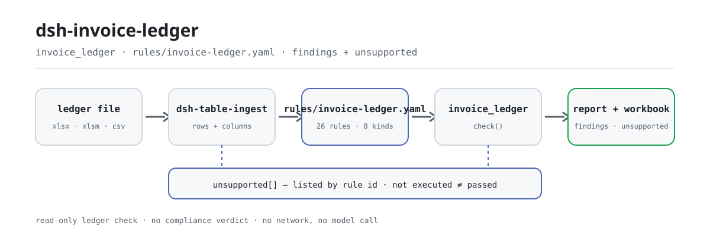

<div align="center">

<picture>
  <source media="(prefers-color-scheme: dark)" srcset="docs/assets/dsh-invoice-ledger-flow-dark.svg">
  
</picture>

# dsh-invoice-ledger

**Revise o livro de faturas inteiro antes do lançamento — cada diferença aponta a linha e traz o fundamento.**

Complemento de verificação de livros de faturas para o DeepSeek Harness, feito para revisores financeiros e de reembolso: lê um livro e verifica duplicidades, aritmética, titular, datas e modelos; devolve uma lista de anomalias e um livro de trabalho de três folhas. Não altera o original, não acede à rede e não chama nenhum modelo.

[Instalação](#instalação-em-três-passos) · [Configuração](#configuração) · [FAQ](#faq) · [简体中文](README.md) · [English](README.en.md) · [Español](README.es.md) · [Português](README.pt.md) · [हिन्दी](README.hi.md)

[](LICENSE)
[](#compatibilidade)
[](https://www.npmjs.com/package/dsh-invoice-ledger)
[](https://github.com/PerryLink/dsh-invoice-ledger/actions/workflows/ci.yml)
[](#compatibilidade)

[](https://github.com/PerryLink/dsh-invoice-ledger/stargazers)
[](https://www.npmjs.com/package/dsh-invoice-ledger)
[](https://dshfind.com/plugins/PerryLink/dsh-invoice-ledger?ref=badge)
[](https://securityscorecards.dev/viewer/?uri=github.com/PerryLink/dsh-invoice-ledger)
[](https://gitee.com/perrylink/dsh-invoice-ledger)

```sh
dsh plugin --profile <name> add dsh-invoice-ledger
```

</div>

<sub>Complemento da comunidade, sem afiliação com a DeepSeek. Repositório canónico: <https://github.com/PerryLink/dsh-invoice-ledger> (o Gitee é um espelho).</sub>

## O que é

`dsh-invoice-ledger` lê um livro de faturas e revê-o linha a linha: se a mesma fatura está registada duas vezes, se o total é igual à base mais o imposto dentro da tolerância, se o comprador é esta empresa (ou uma filial registada), se a data de emissão cai dentro do período e não está no futuro, e se alguma célula ainda tem texto de modelo. Devolve uma lista de anomalias que aponta a linha e dá o valor real, o esperado, a ação sugerida e o fundamento, além de um livro de trabalho de três folhas.

Há duas decisões deliberadas. Uma duplicidade é identificada por **código + número da fatura, nunca pelo valor**, portanto um erro no valor continua a aparecer como duplicidade. E o relatório enumera, uma a uma, todas as regras que esta versão **não conseguiu executar**: um livro com quatro achados e catorze regras não executadas não são quatro problemas.

## Instalação em três passos

1. **Instalar** (escolha um canal):

   ```sh
   # canal npm (recomendado, versão publicada)
   dsh plugin --profile <name> add dsh-invoice-ledger
   # canal git (main mais recente)
   dsh plugin --profile <name> add github:PerryLink/dsh-invoice-ledger
   # canal tarball: após pnpm pack neste repositório
   dsh plugin --profile <name> add ./dsh-invoice-ledger-<version>.tgz
   ```

   Instalar a partir do código executa primeiro `pnpm install`: o script `prepare` gera `lib/index.mjs` com o tsdown. Se os scripts forem ignorados, é preciso compilar uma vez à mão, senão a ferramenta não aparece.

2. **Configuração mínima** (os valores por omissão funcionam; o `cordis.patch.yml` apenas `insert`a uma linha):

   ```yaml
   - insert:
       - id: dsh-invoice-ledger
         name: dsh-invoice-ledger
   ```

   Todos os parâmetros ajustáveis estão no esquema Schemastery de `src/config.ts`; os limites de cada regra estão em `rules/invoice-ledger.yaml`.

3. **Verificar que está montado**:

   ```sh
   dsh --profile <name> --dump-config | grep dsh-invoice-ledger
   node samples/quickstart/run.mjs --check
   ```

   O exemplo incluído é um livro sintético de cinco linhas (uma duplicidade, um total que não fecha, uma data futura) e deve imprimir:

   ```text
   invoice_ledger: quickstart OK — output matches expected/result.json
   ```

   *Observed from `samples/quickstart/expected/result.json`*

   A entrada do exemplo está em `samples/quickstart/input/`, o resultado esperado em `samples/quickstart/expected/result.json` e uma captura de execução em `docs/assets/quickstart.png`. Numa sessão também pode dizer (o `dsh.demo.prompt` de `package.json`):

   ```text
   用自带样例核对一遍发票台账，告诉我发现了几条问题、分别是什么级别。
   ```

**Desinstalar**: `dsh plugin --profile <name> remove dsh-invoice-ledger` (ou remova a linha do patch do perfil).

<details>
<summary>Instalar a partir do mercado DSH Desktop</summary>

Todos os complementos da PerryLink podem ser vistos no mercado integrado do DSH Desktop: **Mercado → Origens → Adicionar origem → colar** `https://perrylink-dsh-catalog.perrylink.workers.dev/catalog-source.json` **→ selecionar**. A instalação continua a exigir a verificação de identidade npm do mercado e a sua confirmação.

</details>

## Capacidades principais

O complemento registra a ferramenta `invoice_ledger`: lê um livro (`.xlsx` / `.xlsm` / `.csv`), aplica um pacote de regras versionado, devolve um relatório estruturado e escreve um livro de trabalho.

- **Duplicidades pela chave da fatura, nunca pelo valor** — o número de 20 dígitos da fatura totalmente digitalizada e o código + número da fatura em papel são comparados como texto; a mesma fatura repetida no lote ou entre folhas de reembolso é reportada mesmo com o valor mal escrito.
- **Aritmética de base e imposto** — o total deve ser igual à base mais o imposto dentro da tolerância (o pacote incluído usa 0,02); acima disso é `error`, e uma diferença explicada por um caso especial reconhecido na observação (tributação por diferença, portagens, combustível) é **rebaixada a `warn`, não escondida**.
- **Comprador e contraparte** — o nome e o NIF do comprador são comparados com esta empresa, os seus alias e as filiais registadas; o vendedor é a contraparte, por isso só se verifica se o nome está preenchido, nunca se compara com os nossos dados mestres; as faturas com titular pessoal são permitidas por lista branca de tipos de documento.
- **Datas e período** — a data de emissão tem de ser interpretável, não estar no futuro, não ser anterior à data de constituição e cair dentro do período; os casos de mudança de período, anteriores ao contrato e fora do prazo interno são reportados em separado.
- **Modelos** — as células de comprador, vendedor, número da fatura e observação são analisadas à procura de texto de modelo; os padrões estão ancorados, pelo que um número real de 20 dígitos não é marcado por engano.
- **Regras não executadas à vista** — das 26 regras do pacote, esta versão executa 12 e implementa 8 tipos de verificação; as outras 14 são listadas por id e tipo. **Não executada não é aprovada.**
- **Relatório e livro de trabalho** — o relatório Markdown lista primeiro as regras não executadas e depois os achados; o livro tem três folhas: resumo, lista de anomalias (uma linha por achado) e regras não executadas.
- **Apenas leitura e local** — o original nunca é alterado, não há chamadas de rede nem ao modelo; a única escrita é o livro de anomalias.

```text
arquivo do livro ──dsh-table-ingest──▶ linhas/colunas ──26 regras──▶ invoice_ledger ──▶ achados + livro
                                        ▲                                                │
                                        └────── regras não executadas por id ────────────┘
```

### O que responde

- A mesma fatura está registada duas vezes, talvez em duas folhas de reembolso?
- O total coincide com a soma de base e imposto dentro da tolerância?
- O comprador é realmente esta empresa, ou uma filial registada?
- O nome do vendedor está preenchido? O vendedor é a contraparte, por isso não é comparado com o nome da nossa empresa.
- A data de emissão está dentro do período, não está no futuro e respeita o prazo interno?
- Que células ainda têm texto de modelo, como um nome de empresa de exemplo?

E, explicitamente: **que regras não foram executadas?**

## Configuração

Todos os parâmetros ajustáveis são campos Schemastery em `src/config.ts`; basta editar o `cordis.yml` para produzirem efeito, sem tocar no código. Os limites de cada regra estão em `rules/invoice-ledger.yaml`.

| Chave | Tipo | Valor por omissão | Significado |
|---|---|---|---|
| `rulePackFile` | string | `rules/invoice-ledger.yaml` | Caminho do pacote de regras, relativo à raiz do pacote |
| `timeoutMs` | number | `120000` | Orçamento de tempo de espera da ferramenta (milissegundos) |
| `workbook` | string | `invoice-anomalies.xlsx` | Nome do ficheiro de anomalias; vazio devolve apenas base64 |

Parâmetros da ferramenta (sobrescritos em cada chamada):

- `file` — caminho absoluto do livro (`.xlsx` / `.xlsm` / `.csv`), obrigatório.
- `today` — data de referência (`YYYY-MM-DD`) para as verificações de data futura e prazo; por omissão, hoje.
- `rulePackFile` — pacote de regras desta chamada, sobrepõe-se ao valor da configuração.
- `outFile` — onde esta chamada escreve o livro de trabalho; vazio usa o `workbook` configurado.

Exemplo de substituição no patch do perfil:

```yaml
- insert:
    - id: dsh-invoice-ledger
      name: dsh-invoice-ledger
      config:
        rulePackFile: rules/invoice-ledger.yaml
        timeoutMs: 180000
        workbook: invoice-anomalies.xlsx
```

> A documentação antiga chamava `rulesFile` à chave do pacote de regras; a chave atual do esquema é `rulePackFile`, definida em `src/config.ts`.

## FAQ

<details>
<summary>Altera o meu livro ou envia dados para a internet?</summary>

Não. A ferramenta apenas lê o livro que lhe entrega e a sua única escrita é o livro de anomalias em `outFile` / `workbook`; o complemento é ESM puro, sem chamadas de rede nem ao modelo. Se o livro não puder ser escrito, `workbookPath` fica vazio mas o relatório e o `workbookBase64` continuam a ser devolvidos: o resultado nunca se perde em silêncio.

</details>

<details>
<summary>«Não executada» pode ser lida como «aprovada»?</summary>

Não. O relatório lista primeiro as regras não executadas (id + título + tipo), o livro tem uma folha dedicada e o resultado inclui `unsupportedCount` e `unsupported[]`. A falta de uma coluna de entrada não transforma uma verificação em aprovada: apenas não chega a uma conclusão. «Não executada ≠ aprovada» está escrito no relatório como declaração firme.

</details>

<details>
<summary>A duplicidade entre períodos é mesmo verificada?</summary>

Esta versão não tem ponto de entrada para o histórico: o `duplicateAcross` compara apenas as folhas de reembolso do lote atual, e o relatório di-lo nas suas notas. Para verificar duplicidades entre períodos, junte o histórico ao material atual ou aguarde uma versão que acrescente a entrada.

</details>

<details>
<summary>Instala-se, mas a ferramenta não aparece: o que fazer?</summary>

Verifique que `main` aponta para `lib/index.mjs` e que `pnpm run build` o gerou; ao instalar a partir do git ou de um tarball, o `prepare` compila por si, mas `--ignore-scripts` salta essa compilação. Depois confirme a montagem com `dsh --profile <name> --dump-config | grep dsh-invoice-ledger`.

</details>

<details>
<summary>A instalação rejeita o pacote por incompatibilidade: o que fazer?</summary>

Este pacote destina-se a DSH `>=0.2.1-0 <0.3.0` e Node `^22.19.0 || >=24.0.0`; o intervalo peer de `@deepseek-ai/dsh-tools` é `>=0.1.2-rc.1 <0.2.0 || >=0.2.0-0 <0.3.0`. Se o seu runtime estiver fora, conceda a isenção explícita que o host oferece em vez de forçar um núcleo antigo.

</details>

## Limite de segurança

- **Apenas diferenças, sem veredicto.** O complemento compara o livro consigo mesmo e com a face da fatura; não decide se uma fatura é falsa, não verifica a realidade do negócio, não consulta a autoridade fiscal e não substitui a revisão financeira. A taxa face ao bem, a numeração sequencial e a concentração no mesmo dia são avisos de risco, não conclusões.
- **O original nunca é alterado.** O livro é apenas de leitura; a única saída é o livro de anomalias em `outFile` ou `workbook`.
- **Os números continuam texto.** O número de 20 dígitos é guardado como texto do início ao fim: excede o intervalo inteiro seguro do JavaScript e convertê-lo perderia os últimos dígitos, o que faria duas faturas diferentes compararem-se como iguais.
- **Citações honestas.** O pacote nunca inventa uma cláusula: quando o texto exato não está disponível, di-lo no `excerpt` e marca a regra como `derived-from-principle`; a gravidade segue a evidência (as regras de princípio têm teto `warn`, os limites da instituição, `info`).
- **O não executado nunca é «aprovado».** As verificações não implementadas são listadas por nome em `unsupported[]` e na folha de regras não executadas; se faltar uma coluna de entrada, a verificação pode nem disparar — nenhum dos casos é uma aprovação.

## Limitações conhecidas

- **Apenas 12 das 26 regras correm.** Esta versão implementa 8 tipos de verificação: `invoiceKey`, `moneyEquation`, `uniqueInvoice`, `duplicateAcross`, `dateWindow`, `partyMatch`, `partyCompare`, `placeholderScan`; as outras 14 são listadas por id como não executadas e nunca são reportadas como aprovadas.
- **Apenas tabelas.** A ferramenta aceita `.xlsx` / `.xlsm` / `.csv` (uma fatura por linha); digitalizações, imagens e PDF/OFD ficam de fora e não há OCR.
- **A duplicidade histórica não é comparada.** O `duplicateAcross` não tem entrada de histórico nesta versão e compara apenas o lote atual; o relatório di-lo e nunca afirma que o histórico foi verificado.
- **O âmbito é o livro e a face da fatura.** Não verifica autenticidade, realidade do negócio nem elegibilidade para dedução; a taxa face ao bem, a numeração sequencial e a concentração no mesmo dia são apenas avisos de amostragem.
- **Sem interface de cliente.** É um complemento puramente host: só registra a ferramenta `invoice_ledger`, sem comando, slot de cliente ou rota HTTP.
- **O pacote é substituível, não está tudo implementado.** Troque `rules/*.yaml` para mudar o conjunto de regras; uma regra nova que use um `kind` não implementado continua a aparecer como não executada.

## Normas que segue

O pacote cita literalmente as suas fontes, junto à regra que as usa, e o `check:citations` verifica que cada excerto aparece tal e qual. Por exemplo:

- Numeração de fatura eletrónica: Aviso 11/2024 da Administração Estatal de Impostos, artigo 4: 20 dígitos, os dois primeiros o ano, 3–4 a região provincial, o 5 o canal de emissão e 6–20 a sequência.
- As identidades aritméticas (total = base + imposto) são marcadas como `arithmetic`, não como uma citação inventada, porque são identidades, não normas.
- As regras sem cláusula citável dizem-no no seu próprio `excerpt` em vez de inventar uma.

O cabeçalho do pacote também declara o seu limite: verifica o livro e a face da fatura contra si mesmos, não decide fraude nem realidade do negócio, não substitui a verificação da autoridade fiscal e não substitui a revisão financeira; a taxa face ao bem, a numeração sequencial e a concentração no mesmo dia são avisos de risco, não conclusões. O registo completo de verificação de cláusulas está em [`rules/evidence/clauses.md`](rules/evidence/clauses.md).

## Formato do material

Uma linha por fatura. Os campos lidos pelo pacote incluído são `invoiceCode`, `invoiceNumber`, `docType`, `issueDate`, `amount`, `tax`, `total`, `buyerName`, `buyerTaxId`, `sellerName`, `sellerTaxId`, `formNo`, `reimburser`, `remark`; quando falta um campo, as verificações afetadas não chegam a uma conclusão; uma coluna em falta não é uma aprovação e a cobertura é o que dizem `unsupported[]` e a folha de regras não executadas.

O livro de trabalho tem três folhas:

```text
resumo       item / valor (linhas, erros, avisos, informativos, regras executadas / não executadas)
anomalias    uma linha por achado: índice, gravidade, regra, linha, número da fatura, problema,
             valor real, esperado, ação sugerida, fundamento, estado de tratamento
não executadas  id da regra / título / tipo de verificação
```

O exemplo incluído fornece apenas `invoiceNumber`, `docType`, `issueDate`, `amount`, `tax`, `total`, `formNo`, `reimburser`; as verificações das colunas em falta simplesmente não disparam — e também não falham.

## Fontes das regras

Cada regra declara `params.check.kind`; as citações vivem no pacote, junto da regra que as usa, e o `check:citations` verifica que cada uma aparece literalmente.

Vale a pena registar um defeito do pacote publicado: os padrões de modelo incluíam um `00000000` sem âncora, que coincide com a parte sequencial de quase qualquer número de 20 dígitos; todas as faturas seriam marcadas como modelo. Os padrões já estão ancorados e um teste garante que um número real não é marcado. O conjunto incluído é:

```text
^(XX|某某|示例|测试|公司名称|纳税人识别号)$ · .*XX公司.* · .*示例公司.*
^0+$ · ^1+$ · ^12345678$ · ^0{8,}$ · ^1{8,}$
```

## Compatibilidade

| Superfície | Estado |
|---|---|
| Harness | `>=0.2.1-0 <0.3.0` (`package.json#engines.dsh`); intervalo peer de `@deepseek-ai/dsh-tools` `>=0.1.2-rc.1 <0.2.0 \|\| >=0.2.0-0 <0.3.0` |
| Node | `^22.19.0 \|\| >=24.0.0` |
| Plataformas | Onde o DSH correr (ESM puro; sem código nativo, sem rede, sem chamadas ao modelo) |
| Entrada | Livro `.xlsx` / `.xlsm` / `.csv`, uma fatura por linha |

## Solução de problemas

- **O complemento instala-se mas a ferramenta não aparece.** Verifique que `main` aponta para `lib/index.mjs` e que `pnpm run build` o gerou; um `main` errado faz o carregador saltar a entrada em silêncio.
- **`dsh plugin add` rejeita o pacote por incompatibilidade.** O intervalo peer cobre `0.1.x` e `0.2.x`; se o seu runtime estiver fora, conceda a isenção explícita em vez de forçar um núcleo antigo.
- **Uma regra não correu.** Leia `unsupported[]` no resultado ou a folha de regras não executadas do relatório; não executada não é aprovada.
- **Um achado diz que o texto da cláusula não foi obtido.** O pacote tem um portão de citação: não inventa texto, di-lo no `excerpt` e limita a regra a `warn` / `info`. Trate isso como uma lacuna de verificação, não como prova de conformidade.
- **Tudo sai como `warn` / `info`.** É por desenho: o complemento não decide questões legais, fiscais ou de segurança; lista diferenças e lacunas para uma pessoa decidir.

## Ecossistema e qualidade

- [Espelho no Gitee](https://gitee.com/perrylink/dsh-invoice-ledger) (espelho sincronizado; o GitHub é a referência)
- [Página do complemento no dshfind](https://dshfind.com/plugins/PerryLink/dsh-invoice-ledger) (instalações e classificação)
- [Relatório OpenSSF Scorecard](https://securityscorecards.dev/viewer/?uri=github.com/PerryLink/dsh-invoice-ledger) (impulsionado por [.github/workflows/scorecard.yml](.github/workflows/scorecard.yml))
- [Escolha um verificador por material](https://perrylink.github.io/zh/checkers/choose/) (índice completo da família: 62 verificadores + complementos gerais)
- Documentação: [`TROUBLESHOOTING.md`](TROUBLESHOOTING.md) · [`SECURITY.md`](SECURITY.md) · [`CHANGELOG.md`](CHANGELOG.md)

## Desenvolvimento

```sh
pnpm install
pnpm run typecheck   # tsc --noEmit
pnpm test            # vitest: comportamento das regras e semântica de limites
pnpm run build       # tsdown -> lib/index.mjs + lib/index.d.mts
pnpm run verify:self-contained
pnpm run check:lockfile
pnpm run check:readmes
pnpm run check:citations
pnpm pack
node ../scripts/sync-shared.mjs dsh-invoice-ledger   # atualizar o kit partilhado
```

| Caminho | Conteúdo |
|---|---|
| `src/index.ts` | Contrato de complemento funcional: registra `invoice_ledger`, resolve o pacote de regras |
| `src/config.ts` | Configuração Schemastery (3 chaves) |
| `src/engine.ts` | Núcleo puro de verificação: carregamento do pacote, execução, listagem das regras não executadas |
| `src/report.ts` | Relatório Markdown e livro de três folhas |
| `src/shared/` | Kit partilhado copiado (carregador de regras, subconjunto YAML, datas e guardas de redação, tabelas) |
| `rules/invoice-ledger.yaml` | Pacote de regras (26 regras) |
| `rules/evidence/clauses.md` | Registo de verificação de cláusulas |
| `tests/` | vitest: comportamento das regras e semântica de limites |
| `samples/quickstart/` | Exemplo de início rápido num comando |

O pacote de regras é dados, não código: edite `rules/*.yaml` para mudar o conjunto sem tocar em TypeScript, e o pacote é validado ao carregar em vez de ser confiado. As imagens do README são geradas por [`scripts/gen-readme-assets.py`](scripts/gen-readme-assets.py) de forma programática (Python + Pillow) e podem ser executadas novamente; este complemento não tem interface, por isso o hero é um diagrama de fluxo SVG desenhado à mão (par claro/escuro, apenas tokens de superfície de comandos).

Topics: `deepseek-harness`, `dsh`, `dsh-plugin`, `cordis`, `invoice`, `ledger`, `reimbursement`, `duplicate`

## Família e créditos

Este projeto faz parte da família de complementos do DeepSeek Harness mantida pela [PerryLink](https://github.com/PerryLink) (tudo Apache-2.0). Se este complemento o ajudar, **uma estrela** não desbloqueia nada, mas torna mais fácil a próxima pessoa encontrá-lo.

- [@PerryLink](https://github.com/PerryLink) — criador e mantenedor: o pacote de regras e a verificação de cláusulas, o núcleo de verificação, o relatório e o livro de trabalho, e a documentação em cinco idiomas.

<details>
<summary>Expandir todos os plugins</summary>

| Plugin | Estado |
|---|---|
| **[dsh-aqua-input-check](https://github.com/PerryLink/dsh-aqua-input-check)** |  |
| **[dsh-archive-check](https://github.com/PerryLink/dsh-archive-check)** |  |
| **[dsh-auto-review](https://github.com/PerryLink/dsh-auto-review)** |  |
| **[dsh-autotier](https://github.com/PerryLink/dsh-autotier)** | 🧊 CONGELADO — ver o README do repo |
| **[dsh-bid-ca-precheck](https://github.com/PerryLink/dsh-bid-ca-precheck)** |  |
| **[dsh-bid-qual-check](https://github.com/PerryLink/dsh-bid-qual-check)** |  |
| **[dsh-cert-mcp](https://github.com/PerryLink/dsh-cert-mcp)** | 🧊 CONGELADO — ver o README do repo |
| **[dsh-checkpoint-rewind](https://github.com/PerryLink/dsh-checkpoint-rewind)** |  |
| **[dsh-click](https://github.com/PerryLink/dsh-click)** |  |
| **[dsh-composer-history](https://github.com/PerryLink/dsh-composer-history)** |  |
| **[dsh-contract-stance](https://github.com/PerryLink/dsh-contract-stance)** |  |
| **[dsh-customs-doc-check](https://github.com/PerryLink/dsh-customs-doc-check)** |  |
| **[dsh-data-quality](https://github.com/PerryLink/dsh-data-quality)** | 🧊 CONGELADO — ver o README do repo |
| **[dsh-demurrage-ledger](https://github.com/PerryLink/dsh-demurrage-ledger)** |  |
| **[dsh-doublecheck](https://github.com/PerryLink/dsh-doublecheck)** |  |
| **[dsh-drill-script-check](https://github.com/PerryLink/dsh-drill-script-check)** |  |
| **[dsh-eia-guide-check](https://github.com/PerryLink/dsh-eia-guide-check)** |  |
| **[dsh-emergency-plan](https://github.com/PerryLink/dsh-emergency-plan)** |  |
| **[dsh-essay-rubric-check](https://github.com/PerryLink/dsh-essay-rubric-check)** |  |
| **[dsh-evidence-check](https://github.com/PerryLink/dsh-evidence-check)** |  |
| **[dsh-export-ctl-check](https://github.com/PerryLink/dsh-export-ctl-check)** |  |
| **[dsh-fast](https://github.com/PerryLink/dsh-fast)** |  |
| **[dsh-fmea-table-check](https://github.com/PerryLink/dsh-fmea-table-check)** |  |
| **[dsh-forecast-penalty](https://github.com/PerryLink/dsh-forecast-penalty)** |  |
| **[dsh-fund-research](https://github.com/PerryLink/dsh-fund-research)** |  |
| **[dsh-github](https://github.com/PerryLink/dsh-github)** |  |
| **[dsh-gongwen-flow-check](https://github.com/PerryLink/dsh-gongwen-flow-check)** |  |
| **[dsh-gongwen-word-check](https://github.com/PerryLink/dsh-gongwen-word-check)** |  |
| **[dsh-guard-plan-qc](https://github.com/PerryLink/dsh-guard-plan-qc)** |  |
| **[dsh-hazchem-check](https://github.com/PerryLink/dsh-hazchem-check)** |  |
| **[dsh-hazplan-check](https://github.com/PerryLink/dsh-hazplan-check)** |  |
| **[dsh-hidden-risk-map](https://github.com/PerryLink/dsh-hidden-risk-map)** |  |
| **[dsh-hs-classify](https://github.com/PerryLink/dsh-hs-classify)** |  |
| **[dsh-icd-rule-check](https://github.com/PerryLink/dsh-icd-rule-check)** |  |
| **[dsh-industry-research](https://github.com/PerryLink/dsh-industry-research)** |  |
| **[dsh-lawcite-adapter](https://github.com/PerryLink/dsh-lawcite-adapter)** |  |
| **[dsh-laya](https://github.com/PerryLink/dsh-laya)** |  |
| **[dsh-lc-doc-check](https://github.com/PerryLink/dsh-lc-doc-check)** |  |
| **[dsh-learning-gap-check](https://github.com/PerryLink/dsh-learning-gap-check)** |  |
| **[dsh-library](https://github.com/PerryLink/dsh-library)** |  |
| **[dsh-local-ai](https://github.com/PerryLink/dsh-local-ai)** |  |
| **[dsh-lsp-actions](https://github.com/PerryLink/dsh-lsp-actions)** |  |
| **[dsh-mask](https://github.com/PerryLink/dsh-mask)** |  |
| **[dsh-mcp-panel](https://github.com/PerryLink/dsh-mcp-panel)** |  |
| **[dsh-medrec-qc](https://github.com/PerryLink/dsh-medrec-qc)** |  |
| **[dsh-memento](https://github.com/PerryLink/dsh-memento)** | 🧊 CONGELADO — ver o README do repo |
| **[dsh-nsfc-form-check](https://github.com/PerryLink/dsh-nsfc-form-check)** |  |
| **[dsh-nurse-record-check](https://github.com/PerryLink/dsh-nurse-record-check)** |  |
| **[dsh-observe](https://github.com/PerryLink/dsh-observe)** |  |
| **[dsh-origin-rvc-check](https://github.com/PerryLink/dsh-origin-rvc-check)** |  |
| **[dsh-ota-review-check](https://github.com/PerryLink/dsh-ota-review-check)** |  |
| **[dsh-output-styles](https://github.com/PerryLink/dsh-output-styles)** |  |
| **[dsh-paper-doc-adapter](https://github.com/PerryLink/dsh-paper-doc-adapter)** |  |
| **[dsh-permission-rules](https://github.com/PerryLink/dsh-permission-rules)** |  |
| **[dsh-permit-report-check](https://github.com/PerryLink/dsh-permit-report-check)** |  |
| **[dsh-pipeline-check](https://github.com/PerryLink/dsh-pipeline-check)** |  |
| **[dsh-pleading-draft](https://github.com/PerryLink/dsh-pleading-draft)** |  |
| **[dsh-plugin-doctor](https://github.com/PerryLink/dsh-plugin-doctor)** | 🚫 APOSENTADO (repo arquivado) |
| **[dsh-plugin-guide](https://github.com/PerryLink/dsh-plugin-guide)** |  |
| **[dsh-plugin-kit](https://github.com/PerryLink/dsh-plugin-kit)** | 🚫 APOSENTADO (repo arquivado) |
| **[dsh-plugin-upgrade](https://github.com/PerryLink/dsh-plugin-upgrade)** | 🚫 APOSENTADO (repo arquivado) |
| **[dsh-policy-brief-draft](https://github.com/PerryLink/dsh-policy-brief-draft)** |  |
| **[dsh-power-loss-split](https://github.com/PerryLink/dsh-power-loss-split)** |  |
| **[dsh-power-ticket-check](https://github.com/PerryLink/dsh-power-ticket-check)** |  |
| **[dsh-ppap-check](https://github.com/PerryLink/dsh-ppap-check)** |  |
| **[dsh-protest-deadline](https://github.com/PerryLink/dsh-protest-deadline)** |  |
| **[dsh-railway-window](https://github.com/PerryLink/dsh-railway-window)** |  |
| **[dsh-repair-order-qc](https://github.com/PerryLink/dsh-repair-order-qc)** |  |
| **[dsh-research-report](https://github.com/PerryLink/dsh-research-report)** |  |
| **[dsh-review-reply-check](https://github.com/PerryLink/dsh-review-reply-check)** |  |
| **[dsh-rulefile-check](https://github.com/PerryLink/dsh-rulefile-check)** |  |
| **[dsh-safety-brief-check](https://github.com/PerryLink/dsh-safety-brief-check)** |  |
| **[dsh-score](https://github.com/PerryLink/dsh-score)** | 🧊 CONGELADO — ver o README do repo |
| **[dsh-session-sync](https://github.com/PerryLink/dsh-session-sync)** |  |
| **[dsh-site-log-check](https://github.com/PerryLink/dsh-site-log-check)** |  |
| **[dsh-skill-pack-security](https://github.com/PerryLink/dsh-skill-pack-security)** |  |
| **[dsh-soe-decision-check](https://github.com/PerryLink/dsh-soe-decision-check)** |  |
| **[dsh-soilwater-check](https://github.com/PerryLink/dsh-soilwater-check)** |  |
| **[dsh-sop-sync-check](https://github.com/PerryLink/dsh-sop-sync-check)** |  |
| **[dsh-spc-gbt-adapter](https://github.com/PerryLink/dsh-spc-gbt-adapter)** |  |
| **[dsh-talk](https://github.com/PerryLink/dsh-talk)** |  |
| **[dsh-tender-extract](https://github.com/PerryLink/dsh-tender-extract)** |  |
| **[dsh-tender-matrix](https://github.com/PerryLink/dsh-tender-matrix)** |  |
| **[dsh-test-drive](https://github.com/PerryLink/dsh-test-drive)** |  |
| **[dsh-ticktick](https://github.com/PerryLink/dsh-ticktick)** | 🚫 APOSENTADO (repo arquivado) |
| **[dsh-translate](https://github.com/PerryLink/dsh-translate)** |  |
| **[dsh-warranty-calc](https://github.com/PerryLink/dsh-warranty-calc)** |  |
| **[dsh-budget](https://github.com/PerryLink/dsh-budget)** | 🧊 CONGELADO — ver o README do repo |
| **[dsh-claude-move](https://github.com/PerryLink/dsh-claude-move)** | 🧊 CONGELADO — ver o README do repo |
| **[dsh-defend](https://github.com/PerryLink/dsh-defend)** | 🧊 CONGELADO — ver o README do repo |
| **[dsh-draw](https://github.com/PerryLink/dsh-draw)** | 🧊 CONGELADO — ver o README do repo |
| **[dsh-reach](https://github.com/PerryLink/dsh-reach)** | 🧊 CONGELADO — ver o README do repo |
| **[dsh-background-agents](https://github.com/PerryLink/dsh-background-agents)** | 🚫 APOSENTADO (repo arquivado) |
| **[dsh-session-pin](https://github.com/PerryLink/dsh-session-pin)** | 🚫 APOSENTADO (repo arquivado) |
| **[dsh-team-rooms](https://github.com/PerryLink/dsh-team-rooms)** | 🚫 APOSENTADO (repo arquivado) |

</details>

## License

[LICENSE](LICENSE) (Apache License 2.0) © 2026 dsh-invoice-ledger contributors

<p align="center"><sub>Apache-2.0 · complemento da comunidade, sem afiliação com a DeepSeek.</sub></p>
